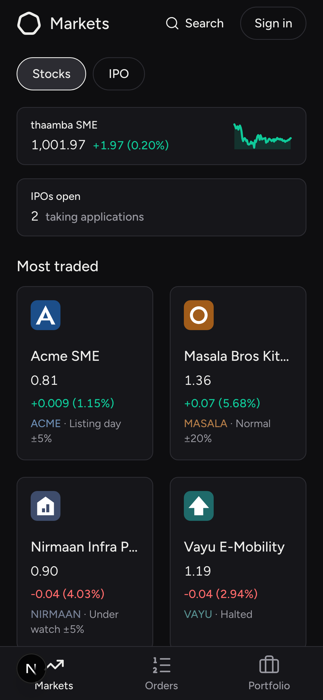
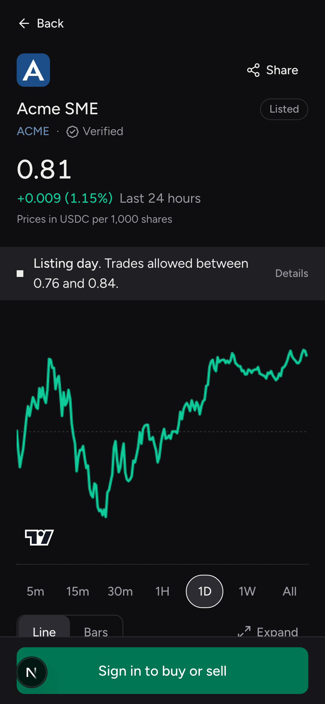
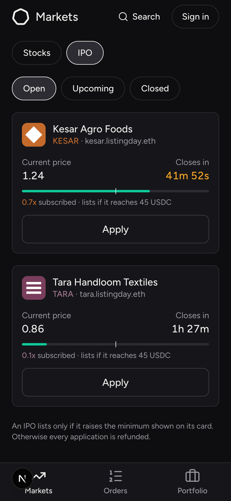
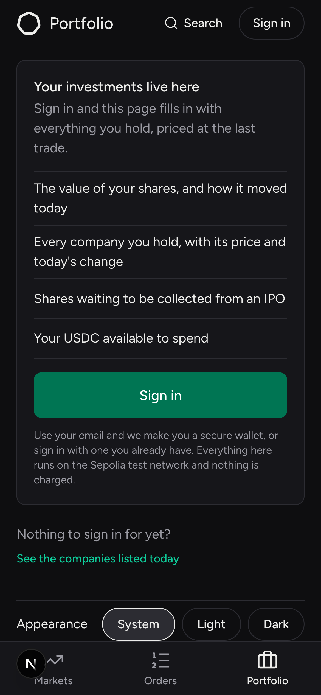
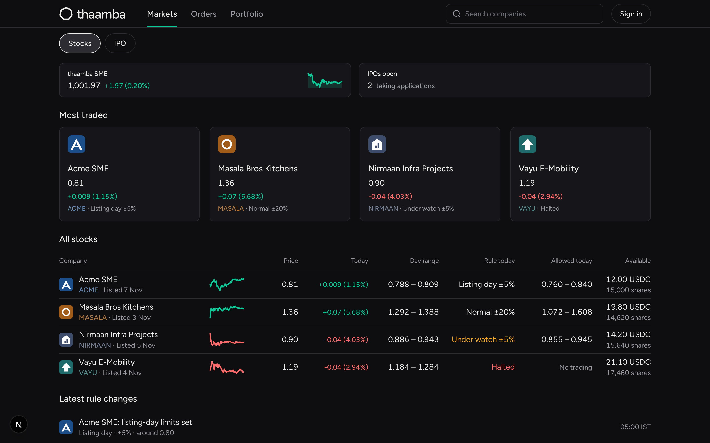
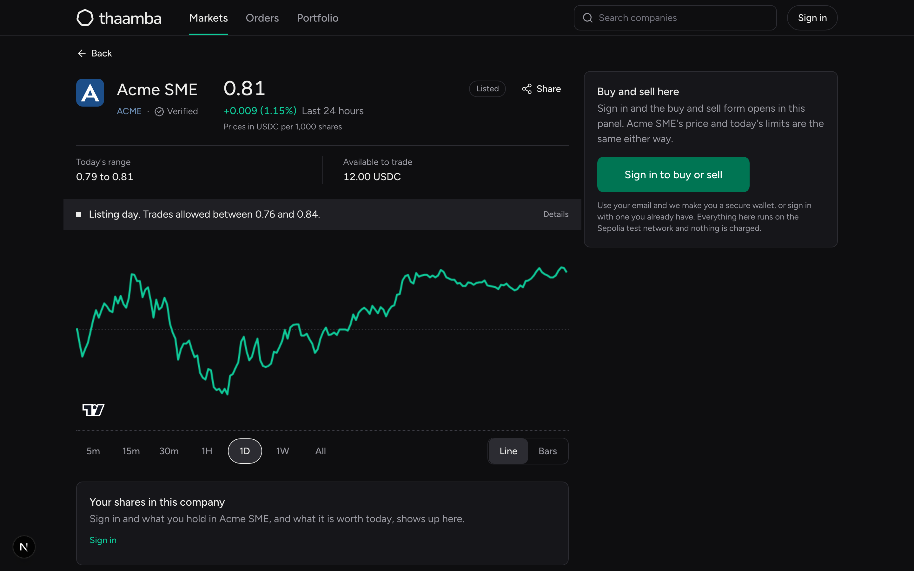
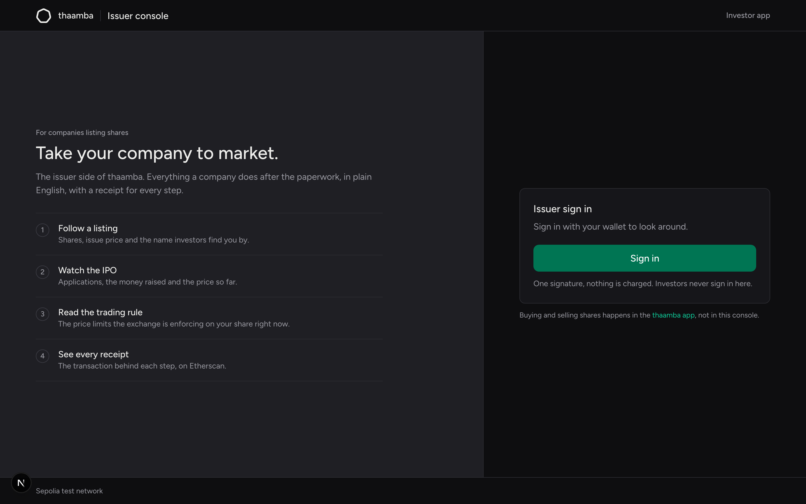
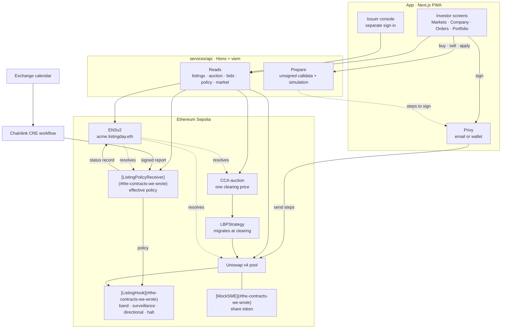

<div align="center">

<picture>
  <source media="(prefers-color-scheme: dark)" srcset="docs/brand/logo-dark.png">
  
</picture>

<br><br>

**Keeping an on-chain share honest about what it is worth.**

A tokenised stock drifts from the real one the moment the real market closes.
thaamba makes that drift cost money, and at the edge makes it impossible.

Built at ETHGlobal Mumbai, 2026 · Ethereum Sepolia

</div>

---

## The problem we are actually solving

A tokenised stock trades around the clock. The share it represents does not.

So the moment the real market shuts, the two prices come apart and nothing pulls
them back. Ondo's S&P 500 token sat at a 0.99 percent premium after one Friday
close, the widest post-close gap measured across platforms. Weekend volume on
tokenised stocks went from $2.4M to $55.2M a day over two months, so this is not
a rounding error any more. The arbitrage that should close the gap runs 24/5,
which is to say it is switched off at exactly the hours the gap opens.

Nobody in the business of issuing these tokens can fix it either. An issuer can
make arbitrage cheaper, and Ondo and Backed both have, but neither controls the
venue where the token actually trades, and an issuer policing secondary prices
starts to look like an unregistered exchange. The only party that could fix it is
the venue. No venue has.

### What thaamba does about it

The price limits live in the pool, so the venue enforces them.

A Chainlink CRE workflow publishes the reference price the real market last
printed, along with the rule in force. A Uniswap v4 hook reads that policy and
checks every single swap against it before the trade settles:

- Outside today's band, the swap reverts. Not a fee, not a warning. It does not happen.
- While the real market is shut, the reference freezes and the pool switches to a one way rule: a trade that pushes the price **further** from the reference is turned away, while a trade that brings it **back** goes through untouched.
- Under surveillance the band tightens. On a halt, trading stops entirely, though liquidity can always be withdrawn.

The result is a market that stays open all weekend without letting the price
wander off, because the only trades it will accept while the reference is stale
are the ones that close the gap rather than widen it.

### And the listing itself

Companies get onto the exchange through an ICO: a Uniswap Continuous Clearing
Auction where everyone who fills pays one clearing price, bids are capped at 190
percent of the issue price, and each wallet has a limit. It is how a company
arrives. It is not the point of the product.

We model the listing rules on India's SME market because they are the clearest
example of an exchange that already thinks this way, with an opening cap, a
listing-day band and a surveillance regime. The difference is that on the NSE
those rules are applied behind a curtain, and here they are code anyone can read
before they trade.

---

## What it looks like

### On a phone

| Markets | Company | ICO | Portfolio |
|---|---|---|---|
|  |  |  |  |

### On the web

Every company, and what it is allowed to do today. The rule in force and the
day's limits sit in the list, not buried on a detail page.



A company page: price, the rule, the chart, and an order panel that refuses a
trade the hook would reject before you ever sign it.



The issuer console is a separate product with its own sign in. Nothing about it
appears in the investor app.



---

## How a listing works

First the company gets an ENSv2 subname. Its records point at the auction, the
pool, the hook and the policy, so the app can resolve a whole listing from the
name and hard-code nothing but the parent.

Then the rule goes up. A Chainlink CRE workflow reads the exchange calendar and
writes a signed report on chain carrying the reference price, the band, the mode
and whether trading is halted.

[Report v5](https://sepolia.etherscan.io/tx/0x30a750da538448312d0cffa756f5dc6d27d19ce7fd4aab38ed01b2fa12a35375) is one of those, live on Sepolia. It arrived through the
[Chainlink forwarder](https://sepolia.etherscan.io/address/0x15fC6AE953E024d975e77382EeEC56a9101F9F88), which is the only address the receiver accepts. It
set the normal band to 20 percent and the surveillance band to 5 percent, left the
mode at normal and the market open, and in the same call the
[policy receiver](#the-contracts-we-wrote) wrote `listed` to the
[Permissioned Resolver](#the-ens-names) as `listingday.status`. One transaction,
the whole path: report in, policy stored, name updated.

The ICO itself is a Uniswap Continuous Clearing Auction. Applications come in,
everyone who fills pays the same clearing price, bids above 190 percent of the
issue price are refused by a validation hook, and each wallet has a cap.

If it raises enough, [LBPStrategy](#uniswap-and-circle-contracts-we-build-on) migrates into a Uniswap v4 pool at exactly the
clearing price, and the [ListingHook](#the-contracts-we-wrote) writes down the listing-day band.

After that every swap goes through the hook. Outside the band it reverts. Under
surveillance the band tightens. In directional mode a trade that widens the gap
to the reference is turned away. A halt stops trading, though liquidity can still
be withdrawn, which is the one thing a halt should never trap.

---

## Deployed on Sepolia

Listing `acme-v1`, deployed at block 12077327.

### The contracts we wrote

| Contract | What it does | Address |
|---|---|---|
| `ListingHook` | The rulebook. Checks every swap against the band in force, and halts. | [`0xf8bbC5E4…f0c0`](https://sepolia.etherscan.io/address/0xf8bbC5E4F9257b1e9EFCb6e7761eA8A05dd0f0c0) |
| `ListingPolicyReceiver` | Takes the signed CRE report and stores the effective policy. | [`0xE57781Ea…EeA0`](https://sepolia.etherscan.io/address/0xE57781EaC05C0e3A9aE7ed9D115e59d50DB7EeA0) |
| `AuctionValidationHook` | The 190 percent bid cap, and the eligibility module behind it. | [`0xB1FCD717…Be002`](https://sepolia.etherscan.io/address/0xB1FCD717C120A7BB8e0732d5C703DEa1682Be002) |
| `AllowAllModule` | The per-wallet application cap, 20 USDC. | [`0x35Fa94d5…a453`](https://sepolia.etherscan.io/address/0x35Fa94d5Be2700D42Bbbc82665eE7B79699Ea453) |
| `MockSME` | The share token, fixed supply of 110,000. | [`0x8F902CAB…8152`](https://sepolia.etherscan.io/address/0x8F902CABeD3D72bd21EFaaC878a490E81aF78152) |
| CCA auction | The ICO book for this listing. | [`0xF36d09f6…5aE3`](https://sepolia.etherscan.io/address/0xF36d09f6C780bde8f09000d87e47B9D3E2EE5aE3) |

### The ENS names

The app resolves a listing from its name. Nothing but the parent is hard-coded.

| Name | Record | Points at |
|---|---|---|
| `acme.listingday.eth` | `addr` | the share token |
| | `listingday.auction` | the CCA book |
| | `listingday.pool` | the v4 pool id |
| | `listingday.hook` | the ListingHook |
| | `listingday.policy` | the policy receiver |
| | `listingday.status` | `draft` / `auction` / `listed` / `surveillance` / `halted` |

| Piece | Address |
|---|---|
| Parent `listingday.eth` subregistry | [`0x6e79404a…deE8`](https://sepolia.etherscan.io/address/0x6e79404aA7cAB39d8ACd921eD5277Ab5A101deE8) |
| Issuer's Permissioned Resolver | [`0x07de0A7f…C844`](https://sepolia.etherscan.io/address/0x07de0A7f6206Ee4b49295EDbd316f24B7912C844) |
| ENSv2 UniversalResolver | [`0xeEeEEEeE…EeEe`](https://sepolia.etherscan.io/address/0xeEeEEEeE14D718C2B47D9923Deab1335E144EeEe) |

The policy receiver holds a role scoped to one record key. It can write
`listingday.status` when CRE halts a market, and it cannot touch anything else on
that name.

### The pool

| | |
|---|---|
| Pool id | `0x61653a49f83d9702ec18151366558a4d08f35daea687bc2af3b5d5a156e450a4` |
| Pair | USDC / MockSME, 0.30 percent fee, tick spacing 60 |
| Listing-day band | plus or minus 5 percent for the first hour |

### Uniswap and Circle contracts we build on

| | Address |
|---|---|
| PoolManager | [`0xE03A1074…3543`](https://sepolia.etherscan.io/address/0xE03A1074c86CFeDd5C142C4F04F1a1536e203543) |
| Universal Router | [`0x3A9D48AB…F98b`](https://sepolia.etherscan.io/address/0x3A9D48AB9751398BbFa63ad67599Bb04e4BdF98b) |
| LiquidityLauncher | [`0x0000FffF…19C0`](https://sepolia.etherscan.io/address/0x0000FffFBE8efE702c8703aE3477FF5dE3d319C0) |
| LBPStrategy | [`0x95434E89…2000`](https://sepolia.etherscan.io/address/0x95434E898Af471945Cab33D5064d2aC1A6Ba2000) |
| Permit2 | [`0x00000000…8BA3`](https://sepolia.etherscan.io/address/0x000000000022D473030F116dDEE9F6B43aC78BA3) |
| USDC | [`0x1c7D4B19…7238`](https://sepolia.etherscan.io/address/0x1c7D4B196Cb0C7B01d743Fbc6116a902379C7238) |

---

## Tools

| | What for |
|---|---|
| **Uniswap v4 + Continuous Clearing Auction** | Price discovery at one clearing price, then a pool whose hook is the rulebook |
| **Chainlink CRE** | The notice board. A workflow joins the exchange calendar to the chain and publishes the rule and halts. [See a live report](https://sepolia.etherscan.io/tx/0x30a750da538448312d0cffa756f5dc6d27d19ce7fd4aab38ed01b2fa12a35375) |
| **ENSv2** | The ticker registry. Subnames, a Permissioned Resolver, and a role scoped to one record |
| **Privy** | Sign in with an email and get an embedded wallet, or bring your own |
| **Circle USDC + Permit2** | Settlement, and the approval path a CCA bid needs |
| **Next.js 16, React 19, Tailwind v4** | The app, as an installable PWA |
| **Lightweight Charts** | The price chart, with band shading and halt columns |
| **Hono + viem** | The exchange server: a thin read and prepare proxy over the contracts |
| **Foundry** | Contracts, fork tests and the deploy scripts |

---

## Repository

| Path | |
|---|---|
| `contracts/` | Solidity, Foundry tests, deploy and ENS scripts |
| `services/api/` | The exchange server. Reads the chain, prepares unsigned calldata, never signs |
| `services/mock-exchange/` | The calendar CRE reads from |
| `app/` | The PWA. See [`app/RUNNING.md`](app/RUNNING.md) |
| `design/` | The design system, brand assets and the screen specs |

---

## Running it

The app needs an exchange server. Either run the real one against Sepolia, or run
the fixture server if you have no chain to hand.

```bash
cd app
cp .env.example .env.local
node dev/api-stub/server.mjs &   # fixtures, port 8788
pnpm install && pnpm dev         # http://localhost:3000
```

For real Sepolia, point `NEXT_PUBLIC_API_URL` at a running `services/api` and
restart. Full instructions, including the Privy app id and the issuer console,
are in [`app/RUNNING.md`](app/RUNNING.md).

### Checks

```bash
cd app && pnpm typecheck && pnpm lint && pnpm test
cd contracts && forge test
cd services/api && npm test
```

---

## What is honest about this

Every exchange rule here is inspired by the NSE but is not the NSE. This is not a
regulated product and makes no regulatory claim. It runs on a test network and
the USDC is test USDC.

Listings are open. There is no identity check and no KYC. The per-wallet cap is
the only limit on an application.

Share transfers are not restricted. The token is a plain ERC-20, so a holder can
move it outside the pool and the hook cannot see it. Real transfer restrictions
need a permissioned token, which is future work.

---

## Team

| | | |
|---|---|---|
| **Ayush Bherwani** | Contracts and CRE | [@ayushbherwani](https://x.com/ayushbherwani) |
| **Harpal Jadeja** | Exchange server | [@harpaljadeja](https://x.com/harpaljadeja) |
| **Sahil Sen** | App and design | [@sensahil](https://x.com/sensahil) |

---

## How the pieces fit



The app never talks to the chain directly for reads. It asks the exchange server,
which runs live calls against one RPC and returns plain numbers. Writes go the
other way: the server prepares unsigned calldata and simulates it, the app shows
what would happen, and the wallet signs. The server never holds a key.
