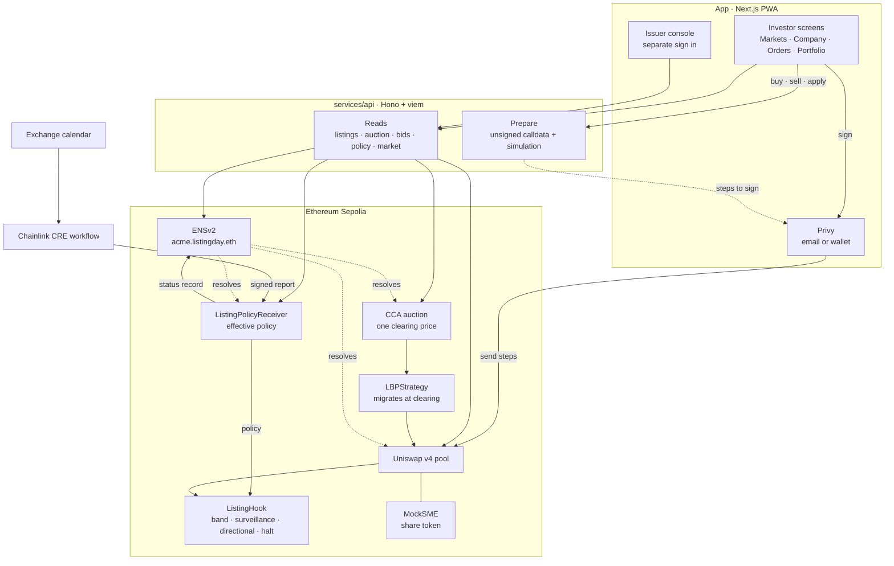

<div align="center">

# thaamba

**An exchange that can say no.**

Indian SME shares, listed and traded on Ethereum. The price limits, the halts and
the allotment are public code instead of a desk nobody can see.

Built at ETHGlobal Mumbai, 2026 · Ethereum Sepolia

</div>

---

## The problem

India already has good rules for small-company listings. An SME IPO opens with a
call auction, the first day trades inside a band of plus or minus 5 percent, and
surveillance can tighten that band whenever it likes. The rules are sensible. The
way they are applied is a black box: the opening cap arrived by circular after
day-one falls of 30 to 50 percent became routine, the allotment lottery is run by
a registrar nobody outside can audit, and a band can change without the reason
ever being published.

Tokenised stocks have the opposite problem. No rules at all. They trade around
the clock on venues that enforce nothing, so when the real market shuts the token
keeps moving and nothing pulls it back until Monday. Ondo's S&P 500 token sat at
a 0.99 percent premium after one Friday close. Weekend volume on tokenised stocks
went from $2.4M to $55.2M a day over two months. The arbitrage that should close
that gap runs 24/5, which is to say it is switched off exactly when the gap
opens.

thaamba puts the rules in the pool. An issuer picks a rulebook at listing, a
Uniswap v4 hook enforces it on every swap, and anyone can read it before they
trade. The market stays open when the one it mirrors is closed.

---

## What it looks like

### On a phone

| Markets | Company | IPO | Portfolio |
|---|---|---|---|
|  |  |  |  |

### On the web

Every company, and what it is allowed to do today. The rule in force and the
day's limits sit in the list, not buried on a detail page.


A company page: price, the rule, the chart, and an order panel that refuses a
trade the hook would reject before you ever sign it.


The issuer console is a separate product with its own sign in. Nothing about it
appears in the investor app.


---

## How a listing works

First the company gets an ENSv2 subname. Its records point at the auction, the
pool, the hook and the policy, so the app can resolve a whole listing from the
name and hard-code nothing but the parent.

Then the rule goes up. A Chainlink CRE workflow reads the exchange calendar and
writes a signed report on chain carrying the reference price, the band, the mode
and whether trading is halted.

The IPO itself is a Uniswap Continuous Clearing Auction. Applications come in,
everyone who fills pays the same clearing price, bids above 190 percent of the
issue price are refused by a validation hook, and each wallet has a cap.

If it raises enough, LBPStrategy migrates into a Uniswap v4 pool at exactly the
clearing price, and the ListingHook writes down the listing-day band.

After that every swap goes through the hook. Outside the band it reverts. Under
surveillance the band tightens. In directional mode a trade that widens the gap
to the reference is turned away. A halt stops trading, though liquidity can still
be withdrawn, which is the one thing a halt should never trap.

---

## Deployed on Sepolia

Listing `acme-v1`, deployed at block 12077327.

### The contracts we wrote

| Contract | What it does | Address |
|---|---|---|
| `ListingHook` | The rulebook. Checks every swap against the band in force, and halts. | [`0xf8bbC5E4…f0c0`](https://sepolia.etherscan.io/address/0xf8bbC5E4F9257b1e9EFCb6e7761eA8A05dd0f0c0) |
| `ListingPolicyReceiver` | Takes the signed CRE report and stores the effective policy. | [`0xE57781Ea…EeA0`](https://sepolia.etherscan.io/address/0xE57781EaC05C0e3A9aE7ed9D115e59d50DB7EeA0) |
| `AuctionValidationHook` | The 190 percent bid cap, and the eligibility module behind it. | [`0xB1FCD717…Be002`](https://sepolia.etherscan.io/address/0xB1FCD717C120A7BB8e0732d5C703DEa1682Be002) |
| `AllowAllModule` | The per-wallet application cap, 20 USDC. | [`0x35Fa94d5…a453`](https://sepolia.etherscan.io/address/0x35Fa94d5Be2700D42Bbbc82665eE7B79699Ea453) |
| `MockSME` | The share token, fixed supply of 110,000. | [`0x8F902CAB…8152`](https://sepolia.etherscan.io/address/0x8F902CABeD3D72bd21EFaaC878a490E81aF78152) |
| CCA auction | The IPO book for this listing. | [`0xF36d09f6…5aE3`](https://sepolia.etherscan.io/address/0xF36d09f6C780bde8f09000d87e47B9D3E2EE5aE3) |

### The ENS names

The app resolves a listing from its name. Nothing but the parent is hard-coded.

| Name | Record | Points at |
|---|---|---|
| `acme.listingday.eth` | `addr` | the share token |
| | `listingday.auction` | the CCA book |
| | `listingday.pool` | the v4 pool id |
| | `listingday.hook` | the ListingHook |
| | `listingday.policy` | the policy receiver |
| | `listingday.status` | `draft` / `auction` / `listed` / `surveillance` / `halted` |

| Piece | Address |
|---|---|
| Parent `listingday.eth` subregistry | [`0x6e79404a…deE8`](https://sepolia.etherscan.io/address/0x6e79404aA7cAB39d8ACd921eD5277Ab5A101deE8) |
| Issuer's Permissioned Resolver | [`0x07de0A7f…C844`](https://sepolia.etherscan.io/address/0x07de0A7f6206Ee4b49295EDbd316f24B7912C844) |
| ENSv2 UniversalResolver | [`0xeEeEEEeE…EeEe`](https://sepolia.etherscan.io/address/0xeEeEEEeE14D718C2B47D9923Deab1335E144EeEe) |

The policy receiver holds a role scoped to one record key. It can write
`listingday.status` when CRE halts a market, and it cannot touch anything else on
that name.

### The pool

| | |
|---|---|
| Pool id | `0x61653a49f83d9702ec18151366558a4d08f35daea687bc2af3b5d5a156e450a4` |
| Pair | USDC / MockSME, 0.30 percent fee, tick spacing 60 |
| Listing-day band | plus or minus 5 percent for the first hour |

### Uniswap and Circle contracts we build on

| | Address |
|---|---|
| PoolManager | [`0xE03A1074…3543`](https://sepolia.etherscan.io/address/0xE03A1074c86CFeDd5C142C4F04F1a1536e203543) |
| Universal Router | [`0x3A9D48AB…F98b`](https://sepolia.etherscan.io/address/0x3A9D48AB9751398BbFa63ad67599Bb04e4BdF98b) |
| LiquidityLauncher | [`0x0000FffF…19C0`](https://sepolia.etherscan.io/address/0x0000FffFBE8efE702c8703aE3477FF5dE3d319C0) |
| LBPStrategy | [`0x95434E89…2000`](https://sepolia.etherscan.io/address/0x95434E898Af471945Cab33D5064d2aC1A6Ba2000) |
| Permit2 | [`0x00000000…8BA3`](https://sepolia.etherscan.io/address/0x000000000022D473030F116dDEE9F6B43aC78BA3) |
| USDC | [`0x1c7D4B19…7238`](https://sepolia.etherscan.io/address/0x1c7D4B196Cb0C7B01d743Fbc6116a902379C7238) |

---

## Tools

| | What for |
|---|---|
| **Uniswap v4 + Continuous Clearing Auction** | Price discovery at one clearing price, then a pool whose hook is the rulebook |
| **Chainlink CRE** | The notice board. A workflow joins the exchange calendar to the chain and publishes the rule and halts |
| **ENSv2** | The ticker registry. Subnames, a Permissioned Resolver, and a role scoped to one record |
| **Privy** | Sign in with an email and get an embedded wallet, or bring your own |
| **Circle USDC + Permit2** | Settlement, and the approval path a CCA bid needs |
| **Next.js 16, React 19, Tailwind v4** | The app, as an installable PWA |
| **Lightweight Charts** | The price chart, with band shading and halt columns |
| **Hono + viem** | The exchange server: a thin read and prepare proxy over the contracts |
| **Foundry** | Contracts, fork tests and the deploy scripts |

---

## Repository

| Path | |
|---|---|
| `contracts/` | Solidity, Foundry tests, deploy and ENS scripts |
| `services/api/` | The exchange server. Reads the chain, prepares unsigned calldata, never signs |
| `services/mock-exchange/` | The calendar CRE reads from |
| `app/` | The PWA. See [`app/RUNNING.md`](app/RUNNING.md) |
| `design/` | The design system, brand assets and the screen specs |

---

## Running it

The app needs an exchange server. Either run the real one against Sepolia, or run
the fixture server if you have no chain to hand.

```bash
cd app
cp .env.example .env.local
node dev/api-stub/server.mjs &   # fixtures, port 8788
pnpm install && pnpm dev         # http://localhost:3000
```

For real Sepolia, point `NEXT_PUBLIC_API_URL` at a running `services/api` and
restart. Full instructions, including the Privy app id and the issuer console,
are in [`app/RUNNING.md`](app/RUNNING.md).

### Checks

```bash
cd app && pnpm typecheck && pnpm lint && pnpm test
cd contracts && forge test
cd services/api && npm test
```

---

## What is honest about this

Every exchange rule here is inspired by the NSE but is not the NSE. This is not a
regulated product and makes no regulatory claim. It runs on a test network and
the USDC is test USDC.

Listings are open. There is no identity check and no KYC. The per-wallet cap is
the only limit on an application.

Share transfers are not restricted. The token is a plain ERC-20, so a holder can
move it outside the pool and the hook cannot see it. Real transfer restrictions
need a permissioned token, which is future work.

---

## Team

| | | |
|---|---|---|
| **Ayush Bherwani** | Contracts and CRE | [@ayushbherwani](https://x.com/ayushbherwani) |
| **Harpal Jadeja** | Exchange server | [@harpaljadeja](https://x.com/harpaljadeja) |
| **Sahil Sen** | App and design | [@sensahil](https://x.com/sensahil) |

---

## How the pieces fit



The app never talks to the chain directly for reads. It asks the exchange server,
which runs live calls against one RPC and returns plain numbers. Writes go the
other way: the server prepares unsigned calldata and simulates it, the app shows
what would happen, and the wallet signs. The server never holds a key.
