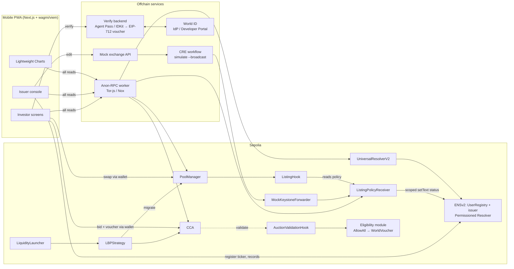
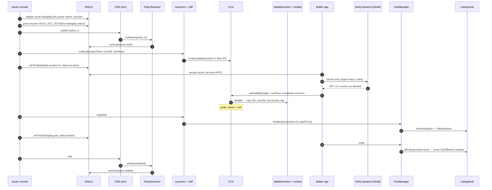
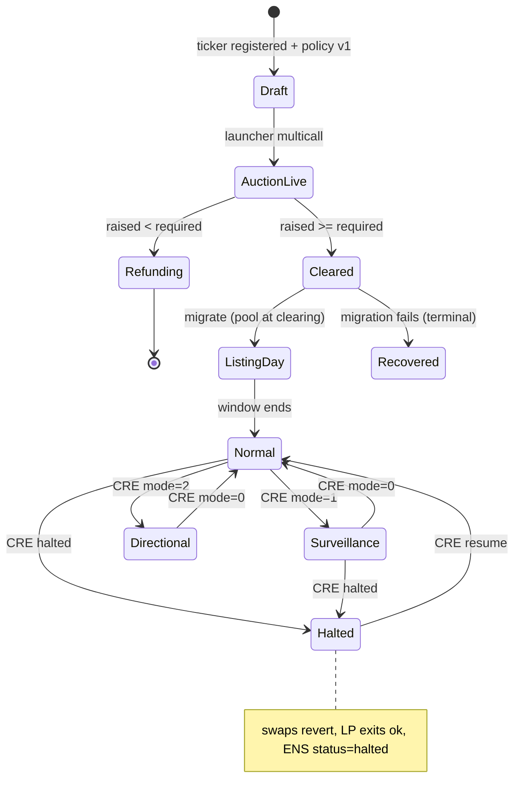

# Listing Day: an SME IPO on Uniswap CCA + v4

> **Public price discovery, private browsing.** A mock Indian SME IPO on Ethereum Sepolia.
> - **Discovery:** a Uniswap Continuous Clearing Auction (CCA).
> - **Graduation:** the token moves into a Uniswap v4 pool, where a `ListingHook` enforces NSE-inspired listing-day and circuit rules.
> - **Policy:** Chainlink CRE posts the listing and incident policy.
> - **Tickers:** ENSv2 gives every SME a ticker name (`acme.listingday.eth`) whose records point to its auction, pool and policy.
> - **Fairness:** World ID enforces one human, one application.
> - **Privacy:** Anon-RPC carries every app read.

| | |
|---|---|
| Event | ETHGlobal Mumbai, Classic track |
| Deadline | **Sat Nov 7 2026, 09:00 IST** (secondary source; confirm on the dashboard) |
| Built into the product | Uniswap · Chainlink CRE · EF Anon-RPC · ENSv2 · World ID (all 5) |
| Claimed at submission | **3 partner prizes only.** See the [Pitch matrix](#2-pitch-matrix); decide after the MetaMask e2e checkpoint. |
| Chain | Ethereum Sepolia (11155111) |
| Client | Mobile-first Next.js PWA, wagmi + viem, MetaMask / WalletConnect |
| Scope | Design only; nothing has been built or deployed |
| Disclaimer | Every exchange rule is an **NSE-inspired mock**: not a regulated product, no regulatory claims |

Last updated Fri Nov 6 2026, ~11:30 IST (v2; v1 kept at `plan.v1.md`).

---

## Contents
1. [Pitch](#1-pitch)
2. [Pitch matrix](#2-pitch-matrix)
3. [Why CCA + v4 fits](#3-why-cca--v4-fits)
4. [IPO mechanics](#4-ipo-mechanics)
5. [Lifecycle](#5-lifecycle)
6. [Components](#6-components)
7. [ENSv2 ticker namespace](#7-ensv2-ticker-namespace)
8. [World ID eligibility](#8-world-id-eligibility)
9. [Mobile app and screens](#9-mobile-app-and-screens)
10. [Diagrams](#10-diagrams)
11. [Rule mapping (NSE-inspired mock)](#11-rule-mapping-nse-inspired-mock)
12. [Mock and demo plan](#12-mock-and-demo-plan)
13. [Build plan to Sat 09:00 IST](#13-build-plan-to-sat-0900-ist)
14. [Risks](#14-risks)
15. [Prize checklists](#15-prize-checklists)
16. [Validation notes](#16-validation-notes)
17. [Reference: addresses and interfaces](#17-reference-addresses-and-interfaces)

---

## 1. Pitch

Indian SME IPOs list through a 45-minute call auction followed by tight price bands. Listing Day rebuilds that flow onchain:

1. **CCA = the call auction.** Fixed supply. Each bid is a budget plus a max price, and everyone pays one uniform clearing price. Bids are capped at 190% of issue price.
2. **v4 pool = the secondary market.** `LBPStrategy` seeds it automatically at the clearing price.
3. **ListingHook = the rulebook.** ±5% listing-day band, 20% normal band, a 5% surveillance mode, a directional mode and a halt. Any swap that lands outside the band reverts. LP exits always work.
4. **CRE = the exchange notice board.** A signed policy report sets the reference price, mode and halt, and mirrors status onto the ticker's ENS record.
5. **ENSv2 = the ticker register.** `acme.listingday.eth` is an issuer-controlled subname. Its records are the IPO's single source of truth, and roles decide who may write which record.
6. **World ID = one human, one application.** A pluggable eligibility module on the auction hook adds a per-human allotment cap, the onchain cousin of NSE application limits.
7. **Anon-RPC = private browsing.** Investors can check a hot IPO without their IP being tied to the addresses they look up.

## 2. Pitch matrix

All five partners are built into the product, but only **3** prizes can be claimed. One EF prize per project.

| Partner | Track (amount) | Key requirements | What we show them | Demo moment | Est. h |
|---|---|---|---|---|---|
| **Uniswap** | Build with Uniswap ($10k: 4/3/2/1k) | Public repo; `FEEDBACK.md`; feedback form linking it; README pointing to contract lines | CCA + LiquidityLauncher/LBPStrategy + v4 `ListingHook` (InitializerHook) + `AuctionValidationHook` | A bid at 200 reverts; graduation opens the pool at 110; a swap to 117 reverts `OutOfBand` | core |
| **Chainlink CRE** | Best workflow with CRE ($1.5k) | Workflow joins a blockchain with an external API and is meaningfully used; simulation accepted | Mock exchange API → report → `ListingPolicyReceiver` → hook policy + ENS status | Issuer taps "Surveillance": CRE sim broadcasts, the band tightens to 5% live | 2 |
| **EF Anon-RPC** | Best Use of Anon-RPC ($5k: 2.5/1.5/1k; one EF prize per project) | App routes RPC reads through Anon-RPC **by default**; judged on end-to-end function, UX, share of traffic, shippability, depth | viem transport = Anon-RPC worker (Tor-js/Nox); badge with a 100% read counter; no silent fallback | Phone shows "Reads via Tor · 100%" while browsing the IPO list | 2–4 |
| **ENS** | Best Use of ENSv2 ($7k: 3/2/1/1k) | Built on ENSv2 on mainnet **or Sepolia**; ENSv2 central, not cosmetic; functional, not hard-coded; live demo link; open source | Ticker namespace: UserRegistry subnames, issuer Permissioned Resolver records, Enhanced Access Control roles (receiver may write only `listingday.status`) | Type "acme" → app resolves auction, pool and policy from ENS; a CRE halt flips the ENS status record | 3–4.5 |
| **World** | **World ID Agent Pass ($5k: 2.5/1.5/1k)**, or Best Use of IDKit ($2.5k, up to 2 teams × $1,250) | *Agent Pass:* official Agent Pass integration; full journey; a denied, expired or cancelled path; secure backend validation; debrief. *IDKit:* IDKit + ≥1 credential verified on server or onchain; explain why the credential is the minimum sufficient; success + alternative path; debrief | Eligibility module: bid needs a backend-signed voucher bound to one human (Agent Pass `sub` or IDKit nullifier) with a per-human cap | A second wallet, same human, tries to apply → voucher denied, bid reverts `NotEligible` | 4–8 |

**Which World track fits:**
- **Agent Pass ($5k)** pays more. It provides a stable pairwise identifier per sector plus fresh authentication at the moment of the action, which maps to "protect scarce benefits / claim limits".
- **IDKit ($2.5k shared)** maps to "fair access to a scarce benefit" with a Proof of Human nullifier.
- Both run through the same backend voucher, so the module design doesn't change. Pick by which SDK reaches first success faster in the World spike.

**Strongest 3-combos (decide after the Sat 01:30 IST e2e checkpoint):**

| Combo | Max pool | Fit | Risk |
|---|---|---|---|
| **A. Uniswap + ENS + EF** | $22k | All three are on the critical path (tickers, rules, private reads) | ENS must be visibly central, not a lookup |
| **B. Uniswap + ENS + World (Agent Pass)** | $22k | Strongest "fair IPO" story | World backend + failure path takes 4–8 h |
| C. Uniswap + EF + World | $20k | Privacy + fairness | Needs World done |
| D. Uniswap + CRE + ENS | $18.5k | CRE is easy to prove via simulation | Smallest pool |

Default lean is **A**, switching to **B** if World lands cleanly by Sat 05:30 IST.

## 3. Why CCA + v4 fits

- **The CCA whitepaper** cites IPO underpricing and names validation hooks and post-auction "compliance gating". Our cap and eligibility hook plus our listing hook are exactly those.
- **StablePair** ([Uniswap](https://x.com/Uniswap/status/2117633841917513745), [Alice Henshaw](https://x.com/hensha256/status/2098106537432510574)) sets a range around a reference price. Swaps pushing the price further off pay no fee; correcting swaps run a Dutch-auction fee. Our directional mode turns the reference-price idea into a circuit rule.
- **Tokenized stocks:** StablePair now pairs Robinhood and Ondo stock tokens ([Hayden](https://x.com/haydenzadams/status/2115123909511233625)), and CCA "is continuing to attract verified token launches" ([Hayden](https://x.com/haydenzadams/status/2115478207088697380)).
- **UHI8 "asset-class specific liquidity":** an SME equity needs listing-day and circuit rules that a generic pool lacks.
- **Routing:** Mark Toda describes default inclusion of hooked pools, with an auto-denylist for hooks that fail often ([post](https://x.com/MarkToda/status/1997286709126386128)). We demo via our own UI and the Universal Router.

## 4. IPO mechanics

| Parameter (issuer console) | Demo value | Onchain mapping |
|---|---|---|
| Fixed supply | **110,000 shares** (MockSME, 18 dec), no mint after launch | LiquidityLauncher `createToken` with fixed supply, or a pre-minted deposit |
| Split | 90,000 to auction / 20,000 reserved for LP | CCA `totalSupply`; `MigratorParameters.reservedTokenAmountForLP` |
| Issue price | 100 mUSDC | Policy v1; anchors range math |
| Discovery range | 80–190% of issue (80 → 190) | CCA `floorPrice` = 80 (Q96); `AuctionValidationHook` rejects `maxPrice` > 190 |
| Per-applicant cap | e.g. 200,000 mUSDC budget per wallet (Phase 1) or per human (Phase 2), a mock application limit | Eligibility module keeps a cumulative committed budget per key |
| % of raise to LP | e.g. 20% | `lpAllocationSchedule` brackets in MigratorParameters |
| Graduation threshold | e.g. 50% of the target raise | CCA `requiredCurrencyRaised` |

**Bids.** Each bid is a **budget** (`amount` in mUSDC) plus a **max price** (`maxPriceQ96`). The bid sheet converts "I'll pay up to ₹X per share with ₹Y" into those two fields. Bids can name an `owner` and carry `hookData`, which is where the World voucher rides.

**Uniform clearing.** Everyone filled pays the same clearing price.
- Bids above clearing are filled.
- Bids exactly at the clearing tick may be partly filled (`exitPartiallyFilledBid`).
- Bids below clearing are refunded via `exitBid`.
- Tokens are claimed after `claimBlock` (`claimTokens` or `claimTokensBatch`).

**Unsold supply.** If demand is short of supply, unsold tokens go to `tokensRecipient`. If the raise is below `requiredCurrencyRaised`, the auction doesn't graduate and every bid is refunded. With LBPStrategy as the initializer, the strategy is the recipient and routes leftovers per its parameters. Confirm the exact path in the Gate 0 fork test, and show "unsold → issuer treasury" in the console.

**Per-applicant caps.** `IValidationHook.validate` is **non-view**, so the module can add `amount` to a running total per key (wallet, or human key) and revert past the cap. Exits don't reduce the total; that is deliberately simple.

## 5. Lifecycle

| # | Phase | What happens | Enforced by |
|---|---|---|---|
| 1 | Draft | Issuer creates the listing in the console, registers `acme.listingday.eth` and publishes policy v1 via CRE sim | Console, ENS, `ListingPolicyReceiver` |
| 2 | CCA live | Floor 80; bids with `maxPrice` > 190 revert; eligibility module checks the cap (and World voucher) | CCA + `AuctionValidationHook` + module |
| 3 | Clears | Graduates if `currencyRaised >= requiredCurrencyRaised`; otherwise refunds | CCA |
| 4 | Migrate | `LBPStrategy.migrate()` initializes the v4 pool **at the clearing price** (~110) and mints LP; the console writes `listingday.pool` and `listingday.status=listed` to ENS | LBPStrategy + `ListingHook.beforeInitialize` |
| 5 | Listing day | ±5% band (104.5–115.5); `afterSwap` reverts swaps that land outside it | `ListingHook` |
| 6 | Normal trading | 20% band around the CRE reference or previous close; surveillance 5%; directional mode; optional halt; LP add and remove never blocked; CRE mirrors status to ENS | `ListingHook` + CRE + ENS |

**A revert can't persist a pause.** A breaching swap rolls back its own writes, so halts arrive only as successful CRE report transactions. Swaps never call CRE.

## 6. Components

| Component | Purpose | Inputs → outputs | Prize | Est. h |
|---|---|---|---|---|
| `MockSME` ERC-20 | Fixed-supply share token (110,000) | Launcher `createToken` or a deposit | Uni | 0.5 |
| `mUSDC` (6 dec) | Faucet quote token | `mint(to, amt)` | Uni | 0.5 |
| `ListingPolicyReceiver` | CRE policy store: version, `maxAge`, chain selector, monotonic `asOf`; best-effort ENS status mirror (try/catch) | `onReport` → `policy()`; `setText(node, "listingday.status", …)` | CRE, ENS | 2 |
| `AuctionValidationHook` | 190% cap + delegates to a pluggable `IEligibilityModule` | `validate(maxPrice, amount, owner, sender, hookData)` | Uni, World | 1.5 |
| `AllowAllModule` (Phase 1) | Per-wallet cumulative cap only | owner, amount → ok / `CapExceeded` | Uni | 0.5 |
| `WorldVoucherModule` (Phase 2) | Checks an EIP-712 voucher signed by our verify backend: `{humanKey, owner, auction, cap, expiry}`; caps by `humanKey`; one wallet per human per auction | hookData voucher → ok / `NotEligible` / `CapExceeded` | World | 1.5 |
| Verify backend (Next.js API routes) | Agent Pass OIDC (or IDKit RP signature + `/v4/verify`), stores the human key, signs vouchers | World result → voucher | World | 2.5–6 |
| CCA + LiquidityLauncher + LBPStrategy | Auction → automatic graduation | Params → auction → pool + LP NFT | Uni | 3 |
| `ListingHook` (inherits `InitializerHook`) | Bands, modes, halt; LP never blocked | `beforeInitialize`, `afterInitialize`, `beforeSwap`, `afterSwap` | Uni | 4 |
| CRE workflow (TS) | Cron or manual → HTTP GET mock exchange API → `writeReport` | JSON → report → receiver | CRE | 2 |
| Mock exchange API | Editable JSON (ref price, mode, halt); the console edits it | Console → JSON | CRE | 0.5 |
| ENS namespace setup | `listingday.eth` → UserRegistry → `acme` subname owned by the issuer; issuer resolver records; scoped roles | Scripts + console | ENS | 3–4.5 |
| Mobile PWA (Next.js + wagmi/viem) | 7 screens incl. the issuer console | Reads via Anon-RPC; writes via the wallet | All | 7–9 |
| Anon-RPC layer | Worker as the viem `custom` transport; badge and counter; no fallback | All `eth_call` / `eth_getLogs` / ENS reads | EF | 2–4 |
| Charts (Lightweight Charts v5) | Pool vs reference, bands, markers, clearing per block | Logs + receipts → series | All | 2 |
| Demo wallets + scripts | 4–6 wallets; bids, swaps, failure paths | Foundry scripts | All | 1.5 |

### Contract sketches (design only)

```solidity
interface IEligibilityModule {
    /// MUST revert to reject. Non-view: may record usage.
    function check(address owner, address sender, uint128 amount, bytes calldata hookData) external;
}

contract AuctionValidationHook is IValidationHook /* + ValidationHookIntrospection */ {
    uint256 public immutable capQ96;          // 1.9 × issue, Q96
    IEligibilityModule public immutable module;
    address public immutable auction;         // set once; only the auction may call validate
    function validate(uint256 maxPrice, uint128 amount, address owner, address sender, bytes calldata hookData) external {
        if (msg.sender != auction) revert OnlyAuction();
        if (maxPrice > capQ96) revert BidAboveCap(maxPrice, capQ96);
        module.check(owner, sender, amount, hookData);
    }
}

// Phase 2 voucher (EIP-712), signed by the verify backend after World validation
struct EligibilityVoucher {
    bytes32 humanKey;   // keccak(Agent Pass iss|sub) or IDKit nullifier, scoped per auction action
    address owner;      // the bidding wallet; one wallet per humanKey per auction
    address auction;
    uint128 cap;        // per-human budget cap (mock application limit)
    uint64  expiry;     // short-lived → "expired" failure path
}

struct ListingPolicy {
    uint32 version; uint64 asOf; uint64 chainSelector; // 16015286601757825753 (Sepolia)
    uint160 refSqrtPriceX96; uint16 normalBandBps; uint16 survBandBps;
    uint8 mode; bool halted; uint64 coolOffUntil;
}
```

Note on wiring: `LBPStrategy` creates the CCA through the factory, so the auction address isn't known when the validation hook is deployed. Either compute it (factory CREATE2 with the salt) or use a one-time `setAuction` by the deployer before `startBlock`. Settle this in Gate 0.

ListingHook: compare prices in sqrtPriceX96 space with precomputed bounds and mind token order. Use `beforeSwap` to `tstore` the pre-price for directional mode. With no liquidity flags set, LPs are never blocked. `authorized` = LBPStrategy `0x9543…2000`; mine the address with HookMiner.

## 7. ENSv2 ticker namespace

**Goal:** each SME ticker is an ENSv2 subname that the issuer controls, and the app resolves *everything* about an IPO from it. The UI hard-codes nothing beyond the parent name.

```
listingday.eth                    (ours, registered on Sepolia ENSv2 via ETHRegistrar / ENS app)
 └─ subregistry: UserRegistry     (deployed via VerifiableFactory; we hold ROLE_REGISTRAR)
     └─ acme  → owner: issuer wallet (ERC-1155 token), resolver: issuer's Permissioned Resolver
```

**Records** on `acme.listingday.eth` (issuer's Permissioned Resolver):

| Key | Value | Written by |
|---|---|---|
| `addr` (60) | MockSME token | Issuer |
| `listingday.auction` | CCA address | Issuer console after launch |
| `listingday.pool` | v4 PoolId (bytes32 hex) | Issuer console after migrate |
| `listingday.hook` | ListingHook address | Issuer |
| `listingday.policy` | `eip155:11155111:<ListingPolicyReceiver>` | Issuer |
| `listingday.status` | `draft` / `auction` / `listed` / `surveillance` / `halted` | **ListingPolicyReceiver only** (scoped role) |
| `description`, `url`, `avatar` | Issuer profile | Issuer |

**Role-scoped records (Enhanced Access Control):**
- The issuer keeps admin roles on their resolver.
- `ListingPolicyReceiver` gets `ROLE_SET_TEXT` scoped to the single key `listingday.status` (via `grantSetterRoles`). A CRE halt can flip the status but can't touch any other record.
- Scoped setter roles apply across **every record bundle in that resolver**, so each issuer uses **their own** resolver instance (the ENSv2 default is one Permissioned Resolver per account). That keeps the receiver's write power limited to that issuer's names.
- Subname token roles: issuer gets `ROLE_SET_RESOLVER` and `ROLE_RENEW`. We withhold `ROLE_CAN_TRANSFER_ADMIN` so a ticker can't be sold away mid-IPO (non-transferable during listing). We keep registry root roles only to unregister a delisted ticker.

**UI resolution.** The app resolves tickers through viem ENS actions pointed at the Sepolia **UniversalResolverV2** (via the `0xeEeE…EeEe` proxy). These reads go through Anon-RPC too. The IPO list is built from the UserRegistry's registration events.

**Hours:**

| Task | Hours |
|---|---|
| Register `listingday.eth` (commit-reveal wait) | 0.5 |
| UserRegistry deploy + `setSubregistry` | 1 |
| Register a ticker + records from the console | 1 |
| Scoped role for the receiver + status mirror | 0.5–1 |
| UI resolution | 1 |
| **Total** | **3–4.5** |

Confirm exact function signatures against `ensdomains/contracts-v2` and the contract-developer tutorial before scripting.

## 8. World ID eligibility

**Phase 1 (MetaMask e2e first):** `AllowAllModule`, a per-wallet budget cap only. Everything works with plain MetaMask.

**Phase 2 (swap-in, 4–8 h):** `WorldVoucherModule`.
1. On the bid sheet, the user taps "Verify you're one applicant". This opens Agent Pass fresh authentication (OIDC) or the IDKit widget (Proof of Human; simulator/staging for the demo).
2. The backend validates the result:
   - **Agent Pass:** ID token from World IdP; human key = hash(`iss`,`sub`).
   - **IDKit:** forward the payload to `POST https://developer.world.org/api/v4/verify/{rp_id}`; human key = the nullifier for action `listingday-<ticker>`.
3. The backend refuses if that human key is already bound to another wallet for this auction. Otherwise it signs a short-lived EIP-712 voucher.
4. The voucher rides in `submitBid(..., hookData)`. The module checks the signer and expiry, binds human key → owner, and enforces the per-human cap.

**Failure paths to demo** (both World tracks require one):
- The same human tries a second wallet → backend denies, no voucher.
- A forged or expired voucher → bid reverts `NotEligible`.
- Cancelled verification → bid button stays disabled.

**Why not verify onchain?** World ID 4.0's `WorldIDVerifier` is deployed on World Chain and Arc, not on Ethereum Sepolia. Ethereum Sepolia has only the legacy v3 `WorldIDRouter` (`0x4694…2157`, Orb-only, legacy proofs). Backend validation + a signed voucher is what both World tracks ask for ("validate in a secure backend"). An onchain legacy-router path is a stretch only.

**Credential choice (IDKit judging asks for it):** Proof of Human is the minimum sufficient assurance. We need uniqueness per applicant, not identity documents.

## 9. Mobile app and screens

**Stack:**
- Mobile-first Next.js PWA with wagmi + viem.
- MetaMask (mobile in-app browser) and WalletConnect first.
- **Anon-RPC for all reads by default.** If an embedded wallet is added later, override its RPC so reads stay on Anon-RPC.
- Writes go through the wallet's own RPC; the README says so plainly.

**Charts:** TradingView **Lightweight Charts** (Apache-2.0). It requires the NOTICE attribution plus a link to tradingview.com; `attributionLogo: true` satisfies the link. Advanced Charts is out: it needs license approval.
- Pool price line (from `Swap` logs via Anon-RPC) and a CRE reference line (from receiver events).
- Upper and lower band **price lines** (`createPriceLine`), updated on mode change.
- **Markers** (`createSeriesMarkers`):
  - Reverted swaps: these emit no logs, so markers come from the app's own tx receipts with `status = 0` plus the demo script's published hashes.
  - Circuit trips: CRE reports with mode or halt changes.
- A baseline series (`BaselineSeries`, `baseValue` = reference) to colour above and below the reference.
- CCA clearing price per block (`ClearingPriceUpdated` / checkpoints) on the auction screen.

**Screens:**

| Screen | Content |
|---|---|
| IPO list | Tickers from ENS, status chip from `listingday.status`, Anon-RPC badge |
| IPO detail + bid sheet | Range, clearing chart, budget + max price, cap remaining, World verify (Phase 2) |
| My bids / allotment | Bid states (active, outbid, partial, filled), exit and claim actions, refund amount |
| Live market chart + trade sheet | Lightweight Charts with band, reference and markers; quote via Quoter; swap via Universal Router; "would revert: outside band" pre-check |
| Circuit status banner | Global: Listing band / Normal / Surveillance / Directional / Halted, with the time it changed (IST) |
| Portfolio | MockSME balance, LP positions, PnL vs issue price |
| **Issuer console** | Create listing (supply 110,000, issue price, range 80–190%, cap, LP %), register ENS ticker, publish policy (CRE sim), launch CCA, monitor bids and clearing, demo buttons (reference update, surveillance, directional, halt, resume) |

The console's demo buttons edit the mock exchange JSON and then run `cre workflow simulate --broadcast` from a local runner script. The judge sees the Sepolia tx. Nothing pretends to be a deployed DON.

## 10. Diagrams

### 10.1 Architecture



### 10.2 Sequence: ticker to listing day



### 10.3 State diagram



## 11. Rule mapping (NSE-inspired mock)

| Real NSE SME rule | Our onchain version | Fidelity |
|---|---|---|
| Opening range capped at 90% above issue (NSE/SME/62757, Jul 2024), floored at 20% below (NSE/CMTR/69388, Aug 2025) | CCA floor 80; hook rejects `maxPrice` > 190 | Close (opening discovery only) |
| Special pre-open: 45-min entry with random close, 10-min match, 5-min buffer; volume-maximising price | CCA uniform-price clearing over blocks | Inspired, not identical |
| No equilibrium → trades at issue price | Not graduated → refunds | Different by design |
| Application limits per applicant | Per-wallet (Phase 1) / per-human (Phase 2) budget cap | Inspired (mock values) |
| Listing day: 5% band if issue ≤ ₹250 Cr, 20% above | ±5% around clearing | Faithful for SME size |
| T2T for the first 10 days | Not modelled | — |
| Emerge normal band 20%; surveillance 5% / 2% | 20% default; CRE mode=1 → 5% (2% configurable) | Close |
| Orders beyond the limit are rejected, not halted | `afterSwap` revert | Faithful |
| — | Timed cool-off, directional mode | Our extensions |
| Market-wide index circuit breakers | Not modelled | — |

## 12. Mock and demo plan

**Example numbers (example data):**
- 110,000 shares (90,000 auctioned), issue 100, range 80–190.
- Clears around 110, so the listing band is 104.5–115.5.
- The CRE reference then shifts from 110 to 90 with directional mode on.

| Step | Pool | Ref | Result |
|---|---|---|---|
| Open | 110 | 110 | ok |
| Buy push | 114 | 110 | ok |
| Buy push | 117 | 110 | **revert** (>115.5) |
| Sell | 108 | 110 | ok |
| Window ends | 108 | 110 | band 88–132 |
| Ref → 90, mode=2 | 108 | 90 | — |
| Buy push | 111 | 90 | **revert** (widens gap) |
| Arb sell | 98 | 90 | ok |
| Halt | 98 | 90 | swaps revert; LP ok; ENS status=halted |

**Demo script (~3.5 min, recorded on a phone plus a screen capture):**
1. **0:00 Pitch:** the NSE SME flow on one slide.
2. **0:20 Issuer console:** create ACME (110,000 shares, 80–190%, 20% to LP) and register `acme.listingday.eth`. The ENS explorer shows the records.
3. **0:45 Publish policy:** CRE sim `--broadcast`; the Sepolia tx appears and ENS status reads `draft`, then `auction`.
4. **1:00 Investor phone:** the IPO list resolves from ENS, with the badge "Reads via Tor · 100%".
5. **1:15 Bid:** World verify, then a bid. A second wallet for the same human is denied. A bid at 200 reverts `BidAboveCap`.
6. **1:50 Clearing:** the clearing chart moves per block. Graduation (pre-run) opens the pool at 110.
7. **2:10 Trade:** an in-band buy passes; a buy to 117 reverts, with a marker on the chart.
8. **2:35 Console:** reference 90 + directional mode. The widening buy reverts and the arb sell passes.
9. **3:00 Halt:** the banner turns red, ENS status reads `halted`, and LP removal still works.
10. **3:20 Close:** the architecture slide and the 3 claimed prizes.

Pre-record the auction phase: Sepolia blocks take ~12 s.

## 13. Build plan to Sat 09:00 IST

About 21.5 h remain from Fri 11:30 IST. **Order: MetaMask e2e first, then ENS, then the World ID swap-in.** The total effort (~35–45 h) needs **two parallel lanes**. A solo builder should cut World and keep combo A.

**Gate 0 (by Fri 13:30 IST):** all of these must pass before anything else.
1. Anon-RPC worker → Sepolia read from a phone browser.
2. CRE `simulate --broadcast` → `onReport` on a stub receiver.
3. Fork test: Launcher → CCA → `migrate()` into a pool with a mined InitializerHook. Confirm the unsold-token path and how to wire the auction address into the validation hook.
4. Register `listingday.eth` on Sepolia ENSv2.

| Time (IST) | Lane A: contracts, CRE, ENS | Lane B: app, Anon-RPC, World |
|---|---|---|
| Fri 11:30–13:30 | Gate 0 (fork test, CRE stub, ENS name) | Gate 0 (Anon-RPC spike on a phone) |
| 13:30–16:00 | Tokens, receiver, validation hook + `AllowAllModule` + tests | PWA shell, wagmi, Anon-RPC transport + badge |
| 16:00–20:00 | `ListingHook` + HookMiner + fork tests | IPO list, detail + bid sheet, My bids |
| 20:00–22:30 | Launch script on Sepolia (params, bids, migrate) | Chart (Lightweight Charts) + trade sheet + circuit banner |
| 22:30–Sat 00:30 | CRE workflow + console runner | Issuer console (create, launch, monitor, demo buttons) |
| **Sat 01:30** | **Checkpoint: MetaMask e2e on Sepolia (bid → clear → trade → revert → halt)** | |
| 00:30–03:30 | ENS: UserRegistry, ticker, records, scoped status role, receiver mirror | ENS resolution in the UI; portfolio |
| 01:30–05:30 | Support, fix, record pieces | World verify backend + `WorldVoucherModule` swap-in (cap 4 h; stop at 05:30) |
| 05:30–07:30 | Joint: rehearsal, video, README line pointers, FEEDBACK.md + form, World/ENS debriefs | |
| 07:30–08:15 | Pick 3 prizes and submit | |
| 08:15–09:00 | Buffer | |

**Cut list, in order:**
1. Ex-dividend (already cut).
2. World ID: fall back to `AllowAllModule` per-wallet cap, combo A.
3. Directional mode.
4. Timed cool-off.
5. Portfolio screen.
6. Receiver's ENS status mirror (the console writes status instead).
7. Previous-close roll.

## 14. Risks

| Risk | Mitigation |
|---|---|
| A pause can't persist in a reverting swap | Reject-only bands; halts only via CRE report transactions |
| InstantLaunch is hookless, so no fallback | LBPStrategy only, proven in Gate 0 |
| LBPStrategy rejects the hook (`InvalidHook`, `PoolIdOccupied`) | Inherit InitializerHook, mine the address, fresh hook or params per run |
| Auction address unknown when deploying the validation hook | Compute the CREATE2 address or a one-time `setAuction` before `startBlock` |
| Migration failure is terminal | Fork-test first; keep a spare run |
| Routers may skip or denylist hooks that revert often | Own UI + Universal Router; frame reverts as rule enforcement |
| Anon-RPC integration takes 2–4 h; Nym bundle ~18 MB; mobile WASM/worker limits | Gate 0 on a real phone; Tor-js first |
| Silent fallback to direct RPC | Never: error with retry; per-transport counter |
| Anon-RPC doesn't hide queried addresses; bootstrap read isn't private | Honest note in the UI and README |
| ENS judged as cosmetic | The UI reads auction, pool and policy *only* from ENS; the CRE status write uses a scoped role; demo the role denial (the receiver can't set `url`) |
| ENS scoped roles span all bundles in a resolver | One resolver per issuer |
| ENSv2 contract API unfamiliar | Follow the contract-developer tutorial; budget 4.5 h; cut the status mirror first |
| World: no ID 4.0 verifier on Ethereum Sepolia | Backend validation + EIP-712 voucher (what the prize asks); onchain legacy router only as a stretch |
| World integration 4–8 h; Agent Pass proofs are mocked identities | Hard stop Sat 05:30 IST; never claim production-grade sybil resistance |
| Voucher signer key is a trust point | Short expiry, one wallet per human key, key only in backend env; stated in README |
| Reverted swaps emit no logs | Chart markers come from app-observed receipts and demo hashes; label "rejected attempts seen by this app" |
| Lightweight Charts licence | NOTICE + `attributionLogo` link to tradingview.com |
| CRE mock forwarder sends no metadata | Forwarder check only during the hackathon |
| Deadline source is secondary | Confirm on the dashboard now |

## 15. Prize checklists

Pick 3 at submission; prepare all 5 so the choice stays open.

**Uniswap ($10k)**
- [ ] Public open-source repo
- [ ] `FEEDBACK.md` (include the CCA factory constructor docs mismatch)
- [ ] Form at https://developers.uniswap.org/hackathon-feedback linking FEEDBACK.md
- [ ] README line pointers: `ListingHook.sol` afterSwap, `AuctionValidationHook.sol` validate, launch script
- [ ] CCA + LBPStrategy + v4 hook on Sepolia, with tx links

**Chainlink CRE ($1.5k)**
- [ ] External API + Sepolia write
- [ ] CRE drives the reference, mode, halt and ENS status
- [ ] `simulate --broadcast` tx hashes
- [ ] README links the workflow and receiver

**EF Anon-RPC ($5k; one EF prize max)**
- [ ] Reads via Anon-RPC by default (incl. ENS resolution)
- [ ] Tor-js / Nox worker, not passthrough
- [ ] Transport + traffic-share UI
- [ ] No silent fallback; honest privacy note

**ENS Best ENSv2 ($7k)**
- [ ] Built on ENSv2 Sepolia (UserRegistry subnames + Permissioned Resolver + EAC roles)
- [ ] Central: the app resolves IPO addresses only from ENS; no hard-coded values
- [ ] Scoped role demo (receiver writes only `listingday.status`)
- [ ] Live demo link on the showcase + open-source repo

**World ($5k Agent Pass, or $2.5k IDKit)**
- [ ] Official integration (Agent Pass, or IDKit + Proof of Human)
- [ ] Full journey: request → completion → backend-validated → bid accepted
- [ ] Failure path: second wallet denied / expired voucher / cancelled
- [ ] No client secrets; no trust in unvalidated client responses
- [ ] Debrief: time to first success, friction, missing docs, top improvement
- [ ] (IDKit) Explain why Proof of Human is the minimum sufficient credential

**ETHGlobal**
- [ ] Exactly 3 partner prizes selected
- [ ] Demo video + live demo link, submitted before Sat 09:00 IST

## 16. Validation notes

Round 1 was checked Fri Nov 6 ~10:20 IST at Sepolia block 12,074,309. Round 2 was checked ~11:20 IST at block 12,074,560.

**Round 1 (unchanged):**
1. All Uniswap/CRE/Anon-RPC Sepolia addresses have code; PositionManager, StateView and Quoter → PoolManager `0xE03A…3543`.
2. LBPStrategy v3.3.0 `initializerFactory()` = CCA factory v2.1.0; its PositionManager and PoolManager match.
3. CCA factory v2.1.0 `protocolFeeController()` = `address(0)`, so no fees. There is a docs mismatch on constructor params.
4. `IValidationHook.validate(uint256,uint128,address,address,bytes)` must revert to reject.
5. LBPStrategy hook rules: pool uninitialized; ERC165 `IInitializerHook`; `authorized()` = LBPStrategy; valid address for the fee; BEFORE_INITIALIZE. Other permissions are unrestricted. `PoolIdOccupied` applies on reuse.
6. The reference InitializerHook on Sepolia has `authorized()` = LBPStrategy.
7. The pool opens at the clearing price.
8. CRE: Sepolia selector `16015286601757825753`; mock forwarder + `--broadcast`; no metadata in simulation; prod metadata is 64 bytes; replay guards.
9. The CRE prize accepts simulation.
10. Anon-RPC: reads by default; passthrough isn't private; bootstrap read isn't private; the RPC sees queried addresses.
11. NSE listing-day band is 5% (≤ ₹250 Cr) / 20%, not 2/5/10%.
12. The NSE FAQ "20% over" is a typo for below.
13. StablePair is fee-based; our blocking directional mode is our extension.
14. Mark Toda: default inclusion + a denylist for failing hooks, not blanket exclusion.
15. The deadline is from a secondary source. Max 3 partner prizes.
16. LiquidityLauncher v3.2.0 is current.
17. Circle Sepolia USDC is 6 dec; we use a mintable mock.

**Round 2 (new facts):**

18. **ENSv2 is live on Sepolia.**
    - The ENS deployments page lists a full Sepolia (ENSv2) set, and the Sepolia ENS apps resolve through it.
    - The Sepolia ENSv1 contracts are "no longer in use".
    - Code confirmed on: RootRegistry `0xb458…c43f`, ETHRegistry `0xd4eb…a8b4`, ETHRegistrar `0xf633…a3d3`, UniversalResolverV2 `0x24e1…2d72`, VerifiableFactory `0xda70…2991`, UserRegistryImpl `0x9bd8…366a`, PermissionedResolverImpl `0x115e…2b2c`.
19. **Mainnet ENSv2 status is mixed.** The prize page says ENSv2 "is now live on Ethereum mainnet". The deployments page says mainnet v2 contracts are deployed "ahead of launch" and that mainnet resolution still runs through v1 until launch completes. Sepolia is explicitly allowed for Best ENSv2, so this doesn't matter for us. The "existing project" ENS prize is Continuity-only and mainnet-only, so it is not ours.
20. **ENS prize requirements:** ENSv2 central, not cosmetic; functional, not hard-coded; **live demo link** on the showcase; open source.
21. **ENS scoped setter roles apply across every record bundle in a resolver,** not just one name. Use one resolver per issuer. Subname ownership (UserRegistry token) and resolver write permission are separate.
22. **World tracks on the Mumbai page (Classic):**
    - World ID Agent Pass is **$5,000** (2.5/1.5/1k).
    - Best Use of IDKit is **$2,500 total, up to 2 teams × $1,250** (not $2,500 per team).
    - The $2,500 Agent Pass and "[Cont] IDKit" tracks are Continuity-only.
23. **Agent Pass is OIDC-based** (World IdP, pairwise `sub` per sector, fresh authentication). It is not IDKit. Agent Pass proofs use mocked identities for the hackathon.
24. **World requirements (both tracks):** backend validation, no client secrets, a demonstrated failed/denied/expired/cancelled path, and an integration debrief. IDKit also asks you to justify the minimum sufficient credential.
25. **World ID 4.0 onchain `WorldIDVerifier`** is deployed on World Chain (prod + staging) and Arc only. **Ethereum Sepolia has only the legacy v3 `WorldIDRouter` `0x469449f2…2157`** (code present; Orb-only, legacy proofs). The design therefore uses backend validation (`POST /api/v4/verify/{rp_id}` or Agent Pass OIDC) plus an EIP-712 voucher checked onchain.
26. **IDKit 4.x needs a backend RP signature** (`signRequest` with the secret signing key). Use the simulator with `environment: "staging"` for the demo. The nullifier must be stored and checked for uniqueness.
27. **`IValidationHook.validate` is non-view,** so per-applicant cumulative caps can be stored. CCA `submitBid` carries `owner` and `hookData`, which is the voucher channel.
28. **CCA unsold tokens go to `tokensRecipient`.** Exits use `exitBid` / `exitPartiallyFilledBid`, and claims happen after `claimBlock`. The route through LBPStrategy still needs confirming in the fork test.
29. **Lightweight Charts** is Apache-2.0 and requires the NOTICE attribution plus a link to tradingview.com (`attributionLogo` satisfies the link). Advanced Charts needs license approval, so it is out.
30. **Reverted transactions emit no logs.** Chart markers for reverted swaps can only come from receipts the app or scripts observed.

## 17. Reference: addresses and interfaces

**Uniswap / CRE / Anon-RPC (Sepolia)**

| Contract | Address |
|---|---|
| PoolManager | `0xE03A1074c86CFeDd5C142C4F04F1a1536e203543` |
| PositionManager | `0x429ba70129df741B2Ca2a85BC3A2a3328e5c09b4` |
| Universal Router | `0x3A9D48AB9751398BbFa63ad67599Bb04e4BdF98b` (2.1.2: `0x7E4f6c5e954Da5c61B3423D81E2277431Ac043f3`) |
| StateView | `0xe1dd9c3fa50edb962e442f60dfbc432e24537e4c` |
| Quoter | `0x68aFa8b853cAa7a2D40B0F6AEE5C4DbC147C8244` |
| Permit2 | `0x000000000022D473030F116dDEE9F6B43aC78BA3` |
| CCA factory v2.1.0 | `0x000000001F26a0044BaA66024e7b6599c61963F8` |
| LiquidityLauncher v3.2.0 | `0x0000FffFBE8efE702c8703aE3477FF5dE3d319C0` |
| LBPStrategy v3.3.0 | `0x95434E898Af471945Cab33D5064d2aC1A6Ba2000` |
| InitializerHook v3.3.0 (ref) | `0x1600059B95A80d500fC42400ea9a88A9C29D2000` |
| CRE MockKeystoneForwarder | `0x15fC6ae953E024d975e77382eEeC56A9101f9F88` |
| CRE KeystoneForwarder | `0xF8344CFd5c43616a4366C34E3EEE75af79a74482` |
| Anon-RPC Nox specifier | `0x35133267A8F7EC35046a83DCA0f4Ca8A6e1b7A9A` |

**ENSv2 (Sepolia)**

| Contract | Address |
|---|---|
| RootRegistry | `0xb458d6a3a77919449d03e7a6903c26827c1ec43f` |
| ETHRegistry | `0xd4ebcbbdf463c9c45784603db0ddd499bc44a8b4` |
| ETHRegistrar | `0xf633e7fc17e2bbe0d0965d18ec1821dcb754a3d3` |
| UniversalResolverV2 | `0x24e1d8e068620b647ca097f961a61055f4f42d72` (proxy `0xeEeEEEeE14D718C2B47D9923Deab1335E144EeEe`) |
| VerifiableFactory | `0xda70306c98e97ece36f997a21368e53298572991` |
| UserRegistryImpl | `0x9bd8a88719068d09ecee662f36c0e3856708366a` |
| PermissionedResolverImpl | `0x115eb53f0c60696633855f90b138178fb40b2b2c` |

**World ID (Ethereum Sepolia):** legacy v3 `WorldIDRouter` `0x469449f251692e0779667583026b5a1e99512157`. This is a stretch only; the plan uses backend verify.

**Sources**
- Uniswap: https://docs.uniswap.org/contracts/v4/deployments · https://docs.uniswap.org/contracts/liquidity-launchpad/deployments · https://github.com/Uniswap/liquidity-launcher · https://github.com/Uniswap/continuous-clearing-auction
- CRE: https://docs.chain.link/cre/guides/workflow/using-evm-client/onchain-write/building-consumer-contracts
- Anon-RPC: https://ethereum.github.io/anon-rpc/wallets/
- ENS: https://docs.ens.domains/learn/deployments · https://docs.ens.domains/ensv2/subnames · https://docs.ens.domains/ensv2/enhanced-access-control/ · https://docs.ens.domains/ensv2/tutorial-contract-developers/
- World: https://docs.world.org/world-id/idkit/integrate · https://docs.world.org/world-id/idkit/onchain-verification · https://auth.world.org/docs
- Prizes: https://ethglobal.com/events/mumbai/prizes · https://ethglobal.com/events/mumbai/prizes/ens · https://ethglobal.com/events/mumbai/prizes/world
- Charts: https://github.com/tradingview/lightweight-charts
- NSE: https://www.nseindia.com/static/products-services/equity-market-special-pre-open-session
