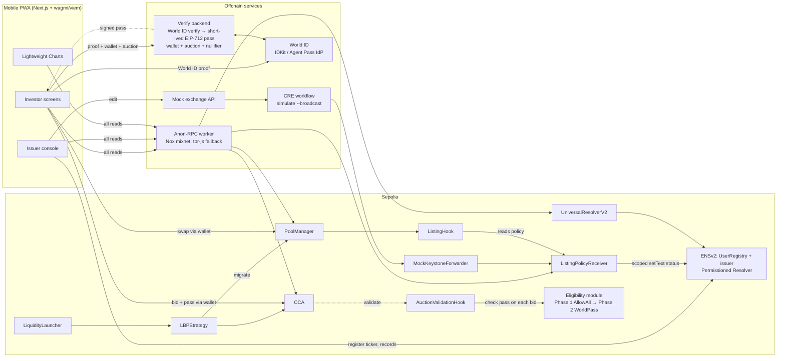
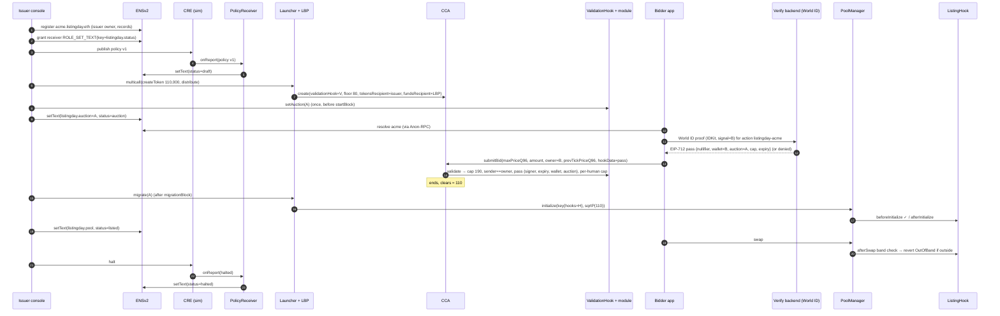
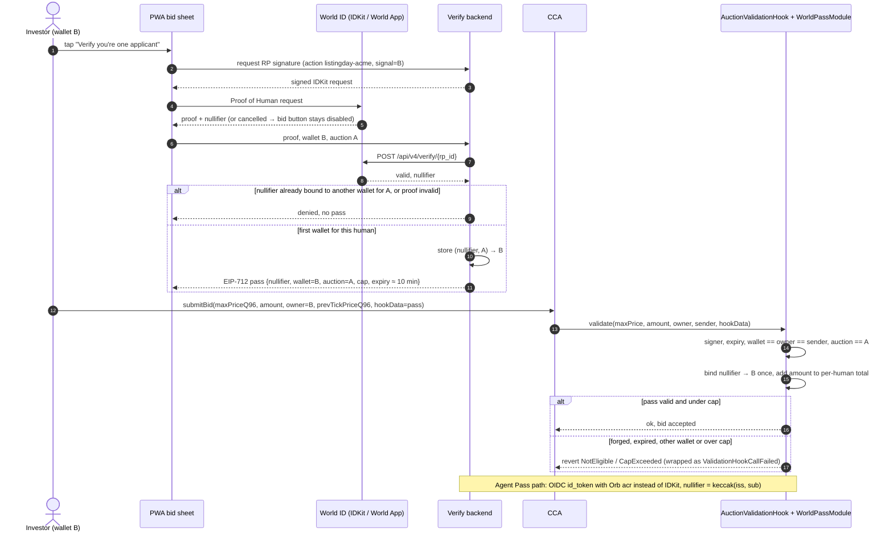
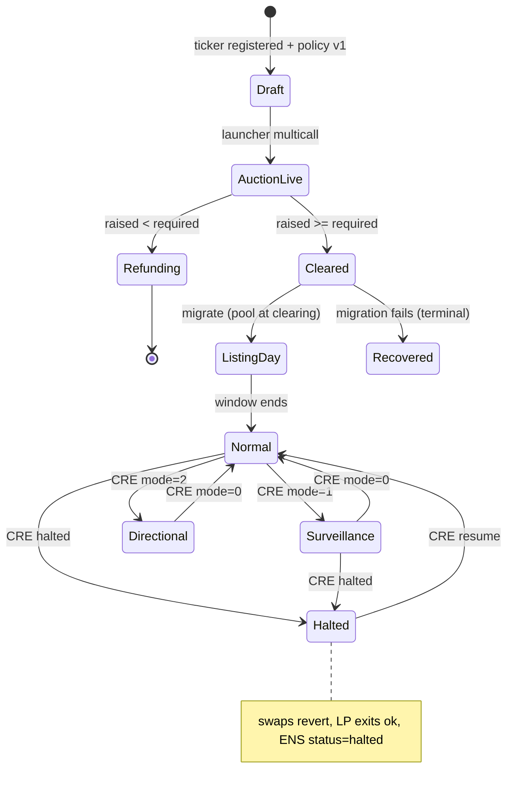

# Listing Day: an SME IPO on Uniswap CCA + v4

> **Public price discovery, private browsing.** A mock Indian SME IPO on Ethereum Sepolia.
> - **Discovery:** a Uniswap Continuous Clearing Auction (CCA).
> - **Graduation:** the token moves into a Uniswap v4 pool, where a `ListingHook` enforces NSE-inspired listing-day and circuit rules.
> - **Policy:** Chainlink CRE posts the listing and incident policy.
> - **Tickers:** ENSv2 gives every SME a ticker name (`acme.listingday.eth`) whose records point to its auction, pool and policy.
> - **Eligibility:** the only rule is "this wallet belongs to a unique real person". Investors prove it with World ID; a backend-signed, short-lived pass carries it to the auction. One human, one application.
> - **Privacy:** Anon-RPC carries every app read.

| | |
|---|---|
| Event | ETHGlobal Mumbai, Classic track |
| Deadline | **Sat Nov 7 2026, 09:00 IST** (03:30 UTC); confirmed on the official [event details page](https://ethglobal.com/events/mumbai/info/details). "Late submissions won't be accepted." |
| Built into the product | Uniswap · Chainlink CRE · EF Anon-RPC · ENSv2 · World ID (all 5) |
| Claimed at submission | **Up to 3 partner prizes.** Several tracks from the same partner count as **one** pick (official rule). See the [Pitch matrix](#2-pitch-matrix); decide after the MetaMask e2e checkpoint. |
| Chain | Ethereum Sepolia (11155111) |
| Client | Mobile-first Next.js PWA, wagmi + viem, MetaMask / WalletConnect |
| Quote currency | Circle **Sepolia USDC** `0x1c7D4B196Cb0C7B01d743Fbc6116a902379C7238` (6 dec); test funds from the [Circle faucet](https://faucet.circle.com/) |
| Scope | Design only; nothing has been built or deployed |
| Disclaimer | Every exchange rule is an **NSE-inspired mock**: not a regulated product, no regulatory claims. The World ID check proves uniqueness only; it is **not KYC** |

Last updated Fri Nov 6 2026, ~14:20 IST (v4: owner decision, eligibility is World ID uniqueness only; v3 was validated against primary sources, see [`VALIDATION.md`](VALIDATION.md)). Earlier versions live in git history.

---

## Contents
1. [Pitch](#1-pitch)
2. [Pitch matrix](#2-pitch-matrix)
3. [Why CCA + v4 fits](#3-why-cca--v4-fits)
4. [IPO mechanics](#4-ipo-mechanics)
5. [Lifecycle](#5-lifecycle)
6. [Components](#6-components)
7. [ENSv2 ticker namespace](#7-ensv2-ticker-namespace)
8. [World ID eligibility](#8-world-id-eligibility)
9. [Mobile app and screens](#9-mobile-app-and-screens)
10. [Diagrams](#10-diagrams)
11. [Rule mapping (NSE-inspired mock)](#11-rule-mapping-nse-inspired-mock)
12. [Mock and demo plan](#12-mock-and-demo-plan)
13. [Build plan to Sat 09:00 IST](#13-build-plan-to-sat-0900-ist)
14. [Risks](#14-risks)
15. [Prize checklists](#15-prize-checklists)
16. [Validation notes](#16-validation-notes)
17. [Reference: addresses and interfaces](#17-reference-addresses-and-interfaces)

---

## 1. Pitch

Indian SME IPOs list through a 45-minute call auction followed by tight price bands. Listing Day rebuilds that flow onchain:

1. **CCA = the call auction.** Fixed supply. Each bid is a budget plus a max price, and everyone pays one uniform clearing price. Bids are capped at 190% of issue price.
2. **v4 pool = the secondary market.** `LBPStrategy` seeds it automatically at the clearing price.
3. **ListingHook = the rulebook.** ±5% listing-day band, 20% normal band, a 5% surveillance mode, a directional mode and a halt. Any swap that lands outside the band reverts. LP exits always work.
4. **CRE = the exchange notice board.** A signed policy report sets the reference price, mode and halt, and mirrors status onto the ticker's ENS record.
5. **ENSv2 = the ticker register.** `acme.listingday.eth` is an issuer-controlled subname. Its records are the IPO's single source of truth, and roles decide who may write which record.
6. **World ID = one human, one application.** This is the only eligibility rule. The investor proves World ID, our backend signs a short-lived pass bound to their wallet, the auction and their World ID nullifier, and the auction's validation hook checks that pass on every bid. It also enforces a per-human allotment cap, the onchain cousin of NSE application limits. See [§8](#8-world-id-eligibility).
7. **Anon-RPC = private browsing.** Investors can check a hot IPO without their IP being tied to the addresses they look up.

## 2. Pitch matrix

All five partners are built into the product, but only **3** partners can be claimed. Several tracks from the same partner count as one pick, so World Agent Pass + IDKit, or EF Anon-RPC + CROPS, cost one slot each. Each selected track's own requirements must still be met. EF places a project in at most one of its tracks (Anon-RPC, alt mempool, CROPS).

| Partner | Track (amount) | Key requirements | What we show them | Demo moment | Est. h |
|---|---|---|---|---|---|
| **Uniswap** | Build with Uniswap ($10k: 4/3/2/1k) | Public repo; `FEEDBACK.md`; feedback form linking it; README pointing to contract lines | CCA + LiquidityLauncher/LBPStrategy + v4 `ListingHook` (InitializerHook) + `AuctionValidationHook` | A bid at 200 reverts; graduation opens the pool at 110; a swap to 117 reverts `OutOfBand` | core |
| **Chainlink CRE** | Best workflow with CRE ($1.5k, single prize) | Workflow joins a blockchain with an external API and is meaningfully used; "simulation is enough" | Mock exchange API → report → `ListingPolicyReceiver` → hook policy + ENS status | Issuer taps "Surveillance": CRE sim broadcasts, the band tightens to 5% live | 2 |
| **EF Anon-RPC** | Best Use of Anon-RPC ($5k: 2.5/1.5/1k). Also select **Best CROPS App** ($3.5k: 2/1/0.5k) under the same EF pick; EF places us in at most one | App routes RPC reads through Anon-RPC **by default**; judged on end-to-end function, UX, share of traffic, shippability, depth. Say which traffic is excluded and why (wallet writes). *CROPS:* OSS licence, a README section titled "CROPS", no trackers, a video showing "the moment it matters" | viem transport = Anon-RPC worker on **Nox** (the only specifier published on Sepolia); tor-js as fallback; badge with a 100% read counter; no silent fallback | Phone shows "Reads via Nox mixnet · 100%" while browsing the IPO list | 2–4 |
| **ENS** | Best Use of ENSv2 ($7k: 3/2/1/1k) | Built on ENSv2 on mainnet **or Sepolia**; ENSv2 central, not cosmetic; functional, not hard-coded; live demo link; open source. Page names "edit only certain text records", non-transferable subnames and per-subname Permissioned Resolvers; **bonus for AI agents** | Ticker namespace: UserRegistry subnames, issuer Permissioned Resolver records, Enhanced Access Control roles (receiver may write only `listingday.status`) | Type "acme" → app resolves auction, pool and policy from ENS; a CRE halt flips the ENS status record | 3–4.5 |
| **World** | **World ID Agent Pass ($5k: 2.5/1.5/1k)** and/or Best Use of IDKit ($2.5k, up to 2 teams × $1,250); one World pick covers both, but select only the track you actually built | *Agent Pass:* official Agent Pass integration; full journey; a denied, expired or cancelled path; secure backend validation; debrief. *IDKit:* IDKit + ≥1 credential verified on server or onchain; explain why the credential is the minimum sufficient; success + alternative path; debrief | Eligibility module: each bid needs a short-lived backend-signed pass bound to wallet + auction + World ID nullifier (IDKit nullifier, or `hash(iss, sub)` from Agent Pass with Orb `acr`), with a per-human cap | A second wallet, same human, tries to apply → pass denied; a bid without a valid pass reverts `NotEligible` | 4–8 |

**Which World track fits:**
- **Agent Pass ($5k)** pays more. It provides a stable pairwise identifier per sector plus fresh authentication at the moment of the action, which maps to "protect scarce benefits / claim limits".
  - The track says it is "especially interested in agentic products" but any compelling use case is eligible.
  - Optional upside: a bidding agent that must pass a World human checkpoint before `submitBid`.
  - The default "Any account" setting admits unverified accounts. One human needs the Orb `acr` (see §8).
- **IDKit ($2.5k shared)** maps to "fair access to a scarce benefit" with a Proof of Human nullifier.
- Both run through the same backend-signed pass, so the module design doesn't change. **Build exactly one path per deployment.** Agent Pass `sub` and IDKit nullifiers live in separate identifier spaces, so offering both would let one person get two passes. Pick by which SDK reaches first success faster in the World spike.

**Strongest 3-combos (decide after the Sat 01:30 IST e2e checkpoint):**

| Combo | Max pool | Fit | Risk |
|---|---|---|---|
| **A. Uniswap + ENS + EF (Anon-RPC + CROPS)** | $22k | All three are on the critical path (tickers, rules, private reads) | ENS must be visibly central, not a lookup |
| **B. Uniswap + ENS + World (Agent Pass)** | $22k | Strongest "fair IPO" story | World backend + failure path takes 4–8 h |
| C. Uniswap + EF + World | $20k | Privacy + fairness | Needs World done |
| D. Uniswap + CRE + ENS | $18.5k | CRE is easy to prove via simulation | Smallest pool |

Default lean is **A**, switching to **B** if World lands cleanly by Sat 05:00 IST. World ID is the whole eligibility story, so its pass check also strengthens the Uniswap pitch (validation hooks as "fair access gating") even when World isn't one of the 3 picks.

**Other Mumbai tracks considered:**
- Hedera "Tokenize Anything" ($5k) and Whitechain "Tokenize · Real World Finance" ($4k) fit tokenized equity, but each needs its own chain.
- Arc "Best DeFi" ($3k) needs Arc.
- Not worth a slot on Sepolia, and switching chains would break ENSv2, Anon-RPC/Nox and the LBPStrategy deployment. Stay on Sepolia.

## 3. Why CCA + v4 fits

- **The CCA whitepaper** cites IPO underpricing and names validation hooks and post-auction "compliance gating". Our cap and eligibility hook plus our listing hook are exactly those.
- **StablePair** ([Uniswap](https://x.com/Uniswap/status/2117633841917513745), [Alice Henshaw](https://x.com/hensha256/status/2098106537432510574)) sets a range around a reference price. Swaps pushing the price further off pay no fee; correcting swaps run a Dutch-auction fee. Our directional mode turns the reference-price idea into a circuit rule.
- **Tokenized stocks:** StablePair now pairs Robinhood and Ondo stock tokens ([Hayden](https://x.com/haydenzadams/status/2115123909511233625)), and CCA "is continuing to attract verified token launches" ([Hayden](https://x.com/haydenzadams/status/2115478207088697380)).
- **UHI8 "asset-class specific liquidity":** an SME equity needs listing-day and circuit rules that a generic pool lacks.
- **Routing:** Mark Toda describes default inclusion of hooked pools, with an auto-denylist for hooks that fail often ([post](https://x.com/MarkToda/status/1997286709126386128)). We demo via our own UI and the Universal Router.

## 4. IPO mechanics

| Parameter (issuer console) | Demo value | Onchain mapping |
|---|---|---|
| Fixed supply | **110,000 shares** (MockSME, 18 dec), no mint after launch | LiquidityLauncher `createToken` with fixed supply, or a pre-minted deposit |
| Split | 90,000 to auction / 20,000 reserved for LP | CCA `totalSupply`; `MigratorParameters.reservedTokenAmountForLP` |
| Quote currency | **Sepolia USDC** (Circle, 6 dec) `0x1c7D…7238` | CCA `AuctionParameters.currency` = `MigratorParameters.currency` (LBPStrategy reverts `CurrencyMismatch` otherwise); see [Quote currency](#quote-currency-sepolia-usdc) |
| Issue price | **0.001 USDC per share = 1.00 USDC per 1,000-share lot**. Price tables use points: issue = 100 = 1.00 USDC per lot | Policy v1; anchors range math. Sized so one faucet request (20 USDC) covers a full application |
| Discovery range | 80–190% of issue (80 → 190 points = 0.80–1.90 USDC per lot) | CCA `floorPrice` = 0.0008 USDC/share in raw-unit Q96; `AuctionValidationHook` rejects `maxPrice` > 190 points |
| Per-applicant cap | **20 USDC** budget per wallet (Phase 1) or per human (Phase 2), a mock application limit. That is one faucet request | Eligibility module keeps a cumulative committed budget per key |
| % of raise to LP | e.g. 20% | `lpAllocationSchedule` brackets in MigratorParameters |
| Graduation threshold | 50% of the target raise: 45 USDC (target = 90,000 × 0.001 = 90 USDC) | CCA `requiredCurrencyRaised` = 45e6 |

**Bids.** Each bid is a **budget** (`amount` in USDC raw units, 6 dec) plus a **max price** (`maxPriceQ96`). The bid sheet converts "I'll pay up to X USDC per lot with Y USDC" into those two fields. The mock is NSE-inspired, but the currency is USDC, not ₹. Bids can name an `owner` and carry `hookData`, which is where the World ID pass rides.

**Uniform clearing.** Everyone filled pays the same clearing price.
- Bids above clearing are filled.
- Bids exactly at the clearing tick may be partly filled (`exitPartiallyFilledBid`).
- Bids below clearing are refunded via `exitBid`.
- Tokens are claimed after `claimBlock` (`claimTokens` or `claimTokensBatch`).

**Unsold supply.** LBPStrategy (v3.3.0) **requires** the auction's `fundsRecipient` to be the strategy and **rejects** the strategy as `tokensRecipient` (`InvalidFundsRecipient` / `InvalidTokensRecipient`). So:
- Unsold auction tokens stay in the CCA and go to `tokensRecipient` (set it to the **issuer treasury**) via `sweepUnsoldTokens()`.
- On migration, raised currency beyond the LP bracket, unused LP reserve tokens and position dust go to `MigratorParameters.recipient`.
- If the raise is below `requiredCurrencyRaised`, the auction doesn't graduate, every bid is refunded via `exitBid`, and the whole supply is sweepable to `tokensRecipient`.
- `migrationBlock` must be strictly after the auction's `endBlock`.

Show "unsold → issuer treasury" in the console and still walk the path once in the Gate 0 fork test.

**Per-applicant caps.** `IValidationHook.validate` is **non-view**, so the module can add `amount` to a running total per key (wallet, or human key) and revert past the cap. Exits don't reduce the total; that is deliberately simple. Require `sender == owner`, as Uniswap's own `GatedERC1155ValidationHook` does, and in Phase 2 also `owner == pass.wallet`. Otherwise anyone who copies a pass from the mempool can spend the victim's cap with their own funds.


### Quote currency: Sepolia USDC

**Owner decision:** bids, the pool and the per-applicant cap use Circle's official **Ethereum Sepolia USDC**, not a faucet mock.
- **Address:** `0x1c7D4B196Cb0C7B01d743Fbc6116a902379C7238`, from [Circle's USDC addresses page](https://developers.circle.com/stablecoins/usdc-contract-addresses).
- **Onchain:** `FiatTokenProxy` → `FiatTokenV2_2` implementation `0xda31…9068`; `decimals()` = 6; `symbol()` = `USDC`.
- **EIP-2612 `permit` is live.** The EIP-712 domain name is **`"USDC"`, version `"2"`**. Mainnet uses `"USD Coin"`, so mainnet signing code won't work here.
- **Admin powers:** Circle can pause or blacklist. It is not fee-on-transfer, which the CCA forbids, so it is compatible.

**Getting USDC (bidders, judges, demo):**
- **Faucet:** [Circle faucet](https://faucet.circle.com/) gives **20 USDC per request, one request per address per chain every 2 hours**. It is public and needs no account. Over the limit it returns "Limit Exceeded". For more, Circle points to its Discord.
- **Bot protection:** the page may also apply captcha or IP throttling (unverified). Budget for manual clicks.
- **In the app:** the PWA shows a "Get test USDC" link to the faucet when a wallet's balance is below the cap. A judge can make one faucet request and place a full 20 USDC application.
- **Demo pre-funding (Gate 0, then every 2 h):** about 6 bidder wallets × 20 USDC, plus 2 trader wallets × ~10 USDC, plus a spare run, comes to **≈ 260 USDC**.
  - From 14:00 IST to the Sat 01:30 checkpoint is about 5 faucet rounds. Eight addresses × 20 USDC × 2 rounds already covers it.
  - Consolidate into a funder wallet, then distribute by script.
  - Sepolia ETH for gas is a separate faucet and must also be pre-funded.

**Knock-on effects:**
- **CCA and LBPStrategy config.**
  - `AuctionParameters.currency` and `MigratorParameters.currency` must both be USDC; LBPStrategy reverts `CurrencyMismatch` otherwise.
  - Leftover USDC after the LP bracket goes to `MigratorParameters.recipient` (issuer treasury).
  - The CCA forbids low-decimal (< 6) currencies; USDC's 6 decimals are at the limit, so they're allowed.
- **Price math (6-decimal quote vs 18-decimal share).** CCA prices are *raw currency per raw token* in Q96:
  - `priceQ96 = P_usdcPerShare × 10^6 / 10^18 × 2^96`.
  - Issue: 0.001 × 10⁻¹² × 2⁹⁶ ≈ 7.9 × 10¹³. That is above the CCA minimum floor of 2³²+1. `tickSpacing` ≈ 1% of the floor.
  - The bid sheet, cap check (190 points), charts and Quoter display all convert with these decimals. The 190% cap is computed on the raw Q96 value.
- **v4 pool currency ordering.** `currency0` is the lower address.
  - USDC `0x1c7D…` sits at ~11% of the address space, so a CREATE2 MockSME is almost always higher. USDC is then **`currency0`**, and the v4 price is *MockSME per USDC* (inverted).
  - LBPStrategy already inverts (`TokenPricing`, `currency < token`).
  - `ListingHook` must be orientation-aware. Store `usdcIsCurrency0` in `afterInitialize`. A "buy MockSME" swap is then `zeroForOne`, and "price up" means `sqrtPriceX96` goes **down**. Upper and lower band bounds swap.
  - Either support both orders or assert the order at deploy (pick the `createToken` salt so MockSME > USDC).
  - Sanity: sqrtPriceX96 ≈ √10¹⁵ × 2⁹⁶ ≈ 2.5 × 10³⁶ (tick ≈ +345,400), within v4 limits.
- **Approvals: the CCA pulls ERC-20 bids through Permit2**, via `SafeTransferLib.permit2TransferFrom` → `Permit2.transferFrom` (AllowanceTransfer).
  - A first-time bidder needs `USDC.approve(Permit2)` once, then `Permit2.approve(USDC, auction, amount, expiration)`, then `submitBid`. That is 3 txs.
  - The CCA has no permit or multicall entry point. A helper "bid router" is ruled out because the validation hook requires `sender == owner`.
  - EIP-2612 `permit` could replace the first `approve`, but only if a contract submits it in the same tx, so in practice the bidder approves.
  - Optional: batch the 3 calls with EIP-5792 `wallet_sendCalls` where MetaMask supports it.
  - Swaps through the Universal Router reuse the Permit2 approval plus a signed `PERMIT2_PERMIT` command, so each swap is one tx.
  - The LiquidityLauncher's Permit2 path only matters for depositing pre-minted MockSME. `createToken` needs no transfer.
- **The ENS registration token is a different token.** `listingday.eth` is paid in ENS's own test **MockUSDC** `0x240b…14aa` (public `mint`), not Circle USDC. Label it "ENS test USDC" in scripts and the console so the two aren't confused.
- **Issuer console and PWA show USDC everywhere:**
  - balances with 6-decimal formatting;
  - prices per 1,000-share lot (e.g. "1.10 USDC / lot"), with per-share values to 5 decimals;
  - the cap as "20 USDC per applicant";
  - a raise progress bar against `requiredCurrencyRaised`;
  - a USDC faucet link;
  - an approve-Permit2 step on the bid sheet.

## 5. Lifecycle

| # | Phase | What happens | Enforced by |
|---|---|---|---|
| 1 | Draft | Issuer creates the listing in the console (incl. eligibility: World ID "one human, one application" on/off), registers `acme.listingday.eth` and publishes policy v1 via CRE sim | Console, ENS, `ListingPolicyReceiver` |
| 2 | CCA live | Floor 80; bids with `maxPrice` > 190 revert; the eligibility module checks the World ID pass (Phase 2) and the cap on every bid | CCA + `AuctionValidationHook` + module |
| 3 | Clears | Graduates if `currencyRaised >= requiredCurrencyRaised`; otherwise refunds | CCA |
| 4 | Migrate | `LBPStrategy.migrate()` initializes the v4 pool **at the clearing price** (~110) and mints LP; the console writes `listingday.pool` and `listingday.status=listed` to ENS | LBPStrategy + `ListingHook.beforeInitialize` (auth, `view`) / `afterInitialize` (store bands) |
| 5 | Listing day | ±5% band (104.5–115.5); `afterSwap` reverts swaps that land outside it | `ListingHook` |
| 6 | Normal trading | 20% band around the CRE reference or previous close; surveillance 5%; directional mode; optional halt; LP add and remove never blocked; CRE mirrors status to ENS | `ListingHook` + CRE + ENS |

**A revert can't persist a pause.** A breaching swap rolls back its own writes, so halts arrive only as successful CRE report transactions. Swaps never call CRE.

## 6. Components

| Component | Purpose | Inputs → outputs | Prize | Est. h |
|---|---|---|---|---|
| `MockSME` ERC-20 | Fixed-supply share token (110,000) | Launcher `createToken` or a deposit | Uni | 0.5 |
| `ListingPolicyReceiver` | CRE policy store: version, `maxAge`, chain selector, monotonic `asOf`; best-effort ENS status mirror (try/catch). Emits its own `PolicyApplied` event. Hackathon guard: the mock forwarder is permissionless, so also require `tx.origin ==` our CRE broadcaster key | `onReport` → `policy()`; `setText(dnsEncode("acme.listingday.eth"), "listingday.status", …)` | CRE, ENS | 2 |
| `AuctionValidationHook` | 190% cap + delegates to a pluggable `IEligibilityModule` | `validate(maxPrice, amount, owner, sender, hookData)` | Uni, World | 1.5 |
| `AllowAllModule` (Phase 1) | Per-wallet cumulative cap only | owner, amount → ok / `CapExceeded` | Uni | 0.5 |
| `WorldPassModule` (Phase 2) | Checks an EIP-712 pass signed by our verify backend: `{nullifier, wallet, auction, cap, expiry}`; requires `wallet == owner` and `auction ==` this auction; binds nullifier → wallet once; caps by nullifier | hookData pass → ok / `NotEligible` / `CapExceeded` | World | 1.5 |
| Verify backend (Next.js API routes) | IDKit RP signature + `/v4/verify` (or Agent Pass OIDC), stores `(nullifier, auction) → wallet`, signs short-lived passes | World ID result → pass | World | 2.5–6 |
| CCA + LiquidityLauncher + LBPStrategy | Auction → automatic graduation | Params → auction → pool + LP NFT | Uni | 3 |
| `ListingHook` (inherits `InitializerHook`) | Bands, modes, halt; LP never blocked | `beforeInitialize` (inherited auth check; `view`, so no writes), `afterInitialize` (store listing price + bands), `beforeSwap`, `afterSwap` | Uni | 4 |
| CRE workflow (TS) | Cron or manual → HTTP GET mock exchange API → `writeReport` with `gasConfig.gasLimit` ≈ 1.5–2M (the ENS mirror is storage-heavy) | JSON → report → receiver | CRE | 2 |
| Mock exchange API | Editable JSON (ref price, mode, halt); the console edits it | Console → JSON | CRE | 0.5 |
| ENS namespace setup | `listingday.eth` → UserRegistry → `acme` subname owned by the issuer; issuer resolver records; scoped roles | Scripts + console | ENS | 3–4.5 |
| Mobile PWA (Next.js + wagmi/viem) | 7 screens incl. the issuer console | Reads via Anon-RPC; writes via the wallet | All | 7–9 |
| Anon-RPC layer | `@anon-rpc/browser-harness` `AnonRpcWorker` on the **Nox** specifier (Sepolia, ~1.8 MB bundle); `worker.fetch` as the viem `custom`/`http({ fetchFn })` transport; badge and counter; no fallback to direct RPC | All `eth_call` / `eth_getLogs` / ENS reads (CCIP-Read off or routed through `worker.fetch`) | EF | 2–4 |
| Charts (Lightweight Charts v5) | Pool vs reference, bands, markers, clearing per block | Logs + receipts → series | All | 2 |
| Demo wallets + scripts | ~8 wallets pre-funded with Sepolia USDC (Circle faucet, 20 USDC / 2 h / address) + Sepolia ETH; funder → distribute script; bids, swaps, failure paths | Foundry scripts | All | 1.5 (+ faucet rounds every 2 h) |

### Contract sketches (design only)

```solidity
interface IEligibilityModule {
    /// MUST revert to reject. Non-view: may record usage.
    function check(address owner, address sender, uint128 amount, bytes calldata hookData) external;
}

contract AuctionValidationHook is ValidationHookIntrospection {
    uint256 public immutable capQ96;          // 1.9 × issue, Q96
    IEligibilityModule public immutable module;
    address public auction;                   // bound once via setAuction; cannot be immutable (see wiring note)
    function setAuction(address a) external;  // deployer-only, once, before startBlock;
                                              // require IContinuousClearingAuction(a).validationHook() == address(this)
    function validate(uint256 maxPrice, uint128 amount, address owner, address sender, bytes calldata hookData) external {
        if (msg.sender != auction) revert OnlyAuction();
        if (sender != owner) revert SenderMustBeOwner();
        if (maxPrice > capQ96) revert BidAboveCap(maxPrice, capQ96);
        module.check(owner, sender, amount, hookData);
    }
}

// Phase 2 pass (EIP-712), signed by the verify backend after World ID validation
struct EligibilityPass {
    bytes32 nullifier;  // World ID nullifier for action listingday-<ticker> (Agent Pass path: keccak(iss|sub))
    address wallet;     // the bidding wallet; must equal bid owner and sender; one wallet per nullifier per auction
    address auction;    // must equal the calling auction
    uint128 cap;        // per-human budget cap (mock application limit)
    uint64  expiry;     // short-lived (~10 min) → "expired" failure path
}

struct ListingPolicy {
    uint32 version; uint64 asOf; uint64 chainSelector; // 16015286601757825753 (Sepolia)
    uint160 refSqrtPriceX96; uint16 normalBandBps; uint16 survBandBps;
    uint8 mode; bool halted; uint64 coolOffUntil;
}
```

Note on wiring (verified in source): the CCA factory deploys with CREATE2 over init code that **includes `AuctionParameters`, and those contain `validationHook`**. The hook address must therefore exist before the auction address can be computed, so the hook **cannot** take the auction as an immutable constructor argument. That would be circular.
- **Use:** a one-time, deployer-only `setAuction(a)`, called right after the launcher multicall and before `startBlock`. It checks `IContinuousClearingAuction(a).validationHook() == address(this)` and `a.token() ==` the expected token. The auction address comes from the factory's `AuctionCreated` event or the strategy's `InitializerCreated` event.
- **Don't bind lazily to the first caller.** Anyone can deploy a CCA through the public factory that points at our hook and claim it first.
- **Alternative (fragile):** precompute with `factory.getAddress(token, auctionSupply, auctionParams, keccak256(abi.encode(keccak256(abi.encode(launcherCaller, salt)), migrationParams)), LBPStrategy)`. The launcher and strategy each re-hash the salt.
- Keep the `msg.sender == auction` check. Without it, anyone could call `validate` directly and burn another wallet's cap.
- The CCA wraps every hook revert as `ValidationHookCallFailed(bytes reason)`. The UI must decode the inner error (`BidAboveCap`, `NotEligible`, `CapExceeded`).

ListingHook: compare prices in sqrtPriceX96 space with precomputed bounds and mind token order. Use `beforeSwap` to `tstore` the pre-price for directional mode. With no liquidity flags set, LPs are never blocked. `authorized` = LBPStrategy `0x9543…2000` (onchain `authorized()` on the reference hook confirms the strategy is a singleton); mine the address with HookMiner.
- A hook revert also makes the v4 Quoter revert. The trade sheet's "would revert: outside band" pre-check is just a failed quote.
- Swaps are not identity-gated: eligibility applies to bids only, and secondary trading on the pool is open to any wallet.

## 7. ENSv2 ticker namespace

**Goal:** each SME ticker is an ENSv2 subname that the issuer controls, and the app resolves *everything* about an IPO from it. The UI hard-codes nothing beyond the parent name.

```
listingday.eth                    (ours, registered on Sepolia ENSv2 via ETHRegistrar / ENS app; paid in ENS MockUSDC)
 └─ subregistry: UserRegistry     (VerifiableFactory.deployProxy(impl, salt, initialize([(us, roleBitmap)])); we hold ROLE_REGISTRAR + ROLE_UNREGISTER)
     └─ acme  → owner: issuer wallet (ERC-1155 token), resolver: issuer's Permissioned Resolver
```

**Records** on `acme.listingday.eth` (issuer's Permissioned Resolver):

| Key | Value | Written by |
|---|---|---|
| `addr` (60) | MockSME token | Issuer |
| `listingday.auction` | CCA address | Issuer console after launch |
| `listingday.pool` | v4 PoolId (bytes32 hex) | Issuer console after migrate |
| `listingday.hook` | ListingHook address | Issuer |
| `listingday.policy` | `eip155:11155111:<ListingPolicyReceiver>` | Issuer |
| `listingday.status` | `draft` / `auction` / `listed` / `surveillance` / `halted` | **ListingPolicyReceiver only** (scoped role) |
| `listingday.eligibility` | `open` (Phase 1, per-wallet cap) / `human` (Phase 2, World ID pass required) | Issuer (before `startBlock`); the app checks it matches the module on the validation hook |
| `description`, `url`, `avatar` | Issuer profile | Issuer |

**Role-scoped records (Enhanced Access Control):**
- The issuer keeps admin roles on their resolver.
- `ListingPolicyReceiver` gets `ROLE_SET_TEXT` scoped to the single key `listingday.status`, via `grantSetterRoles(bytes setter, address account)`. `setter` is the ABI-encoded `setText(bytes name, string key, …)`. The granter needs `ROLE_SET_TEXT_ADMIN` on that resolver; plain `grantRoles` reverts. A CRE halt can flip the status but can't touch any other record.
- ENSv2 setters take a **DNS-encoded name**, not a `bytes32 node`: `setText(bytes name, string key, string value)` and `setAddress(bytes name, uint256 coinType, bytes value)`.
- Scoped setter roles apply across **every record bundle in that resolver**, so each issuer uses **their own** resolver instance (the ENSv2 default is one Permissioned Resolver per account). That keeps the receiver's write power limited to that issuer's names.
- Subname token roles: issuer gets `ROLE_SET_RESOLVER` and `ROLE_RENEW`. We withhold `ROLE_CAN_TRANSFER_ADMIN`, which can only be granted at registration; transfers then revert `TransferDisallowed`. So a ticker can't be sold away mid-IPO. We keep registry root roles only to unregister a delisted ticker.
- **Token ids regenerate** whenever roles change (`TokenRegenerated`). Index tickers by labelhash and look them up with `findTokenId(label)`, never by a cached token id.

**UI resolution.** The app resolves tickers through viem ENS actions (`getEnsAddress`, `getEnsText`). viem's `sepolia` chain already points `ensUniversalResolver` at the `0xeEeE…EeEe` proxy (`UpgradableUniversalResolverProxy` → UniversalResolverV2). These reads go through Anon-RPC too. Disable CCIP-Read (`ccipRead: false`) or route it through `worker.fetch`; otherwise gateway calls would bypass Anon-RPC. The IPO list is built from the UserRegistry's `LabelRegistered` / `LabelUnregistered` / `TokenRegenerated` events.

**Hours:**

| Task | Hours |
|---|---|
| Register `listingday.eth`: `commit`, wait 60 s–24 h, then `register(label, owner, secret, subregistry, resolver, duration ≥ 28 days, paymentToken, referrer)`; mint ENS MockUSDC `0x240b…14aa` (~8 USDC/yr) and `approve` first | 0.5 |
| UserRegistry deploy + `setSubregistry` | 1 |
| Register a ticker + records from the console | 1 |
| Scoped role for the receiver + status mirror | 0.5–1 |
| UI resolution | 1 |
| **Total** | **3–4.5** |

Confirm exact function signatures against `ensdomains/contracts-v2` at tag **`v2-mainnet-deployment-1`**, whose `contracts/deployments/sepolia/*.json` ABIs match the live addresses. Don't use `main`, which holds an older Sepolia deployment with a different resolver API. Also read the contract-developer tutorial before scripting.

## 8. World ID eligibility

**Owner decision:** investor eligibility is **only** "this wallet belongs to a unique real person", proven with World ID. Nothing else about the investor is checked, stored or revealed.

**Phase 1 (MetaMask e2e first):** `AllowAllModule`, a per-wallet budget cap only. Everything works with plain MetaMask.

**Phase 2 (swap-in, 4–8 h):** `WorldPassModule`. The flow is three steps: the investor proves World ID → the backend verifies it and signs a short-lived pass bound to wallet + auction + World ID nullifier → the CCA validation hook checks the pass on each bid.
1. On the bid sheet, the user taps "Verify you're one applicant". This opens **one** of two paths, fixed per deployment: the IDKit widget (Proof of Human; simulator/staging for the demo), or Agent Pass fresh authentication (OIDC). Never offer both for the same auction. The identifier spaces differ, so one person could collect two passes.
2. The backend validates the result and derives the **nullifier**:
   - **IDKit:** the backend creates the request with `signRequest` (RP signing key, never in the client). Set `signal` = the bidder wallet and check it on the backend. Forward the payload to `POST https://developer.world.org/api/v4/verify/{rp_id}`, assert `environment`, and use the nullifier for action `listingday-<ticker>`. Store it with `UNIQUE(nullifier, action)`.
   - **Agent Pass:** request `max_age=0` and `claims={"id_token":{"acr":{"essential":true,"values":["https://world.org/oidc/acr/orb"]}}}`. Validate signature, `aud`, `nonce`, `auth_time`, `acr` and `amr`; the default "Any account" setting is **not** one human. Nullifier = `keccak(iss, sub)`. Use the sandbox IdP (`sandbox.auth.world.org`); hackathon proofs are mocked identities.
3. The backend refuses if that nullifier is already bound to another wallet for this auction. Otherwise it signs a short-lived (~10 min) EIP-712 `EligibilityPass {nullifier, wallet, auction, cap, expiry}`. It stores only `(nullifier, auction) → wallet`.
4. The pass rides in `submitBid(maxPriceQ96, amount, owner, prevTickPriceQ96, hookData)`. On **every** bid, `AuctionValidationHook` → `WorldPassModule` checks the signer, `expiry`, `wallet == owner == sender` and `auction == msg.sender`, binds nullifier → wallet on first use (a different wallet for the same nullifier reverts), and adds `amount` to the per-human total against `cap`.

**Failure paths to demo** (both World tracks require one):
- The same human tries a second wallet → backend denies, no pass.
- A forged, expired or other-wallet pass → bid reverts `NotEligible`.
- Cancelled verification → bid button stays disabled.

**Why not verify onchain?** World ID 4.0's `WorldIDVerifier` is on World Chain only (production + staging). Arc has a `WorldIDSatellite` (production only). Ethereum Sepolia has neither. It has only the legacy v3 `WorldIDRouter` (`0x4694…2157`). That router is still live: the testnet identity manager is on Sepolia itself, the group-1 root updated today, and root expiry is 1 h. But it is Orb-only (`groupId = 1`) and takes legacy proofs. Backend validation + a signed pass is what both World tracks ask for ("validate in a secure backend"). An onchain legacy-router path is a stretch only.

**Credential choice (IDKit judging asks for it):** Proof of Human is the minimum sufficient assurance. We need uniqueness per applicant, not identity documents or any personal attribute, so no other credential is requested.

**Honest limitations (README + UI copy):**
- **Not KYC.** The pass proves "one unique human", not who they are. Hackathon proofs are staging or mocked identities; we never claim production-grade sybil resistance.
- **A human can still bid for someone else.** World ID stops one person applying twice; it can't stop a verified person lending their wallet.
- **Only bids are gated.** After allotment MockSME is a plain ERC-20; transfers and swaps are open to any wallet.
- **The backend is a trust point.** Short expiry, one wallet per nullifier per auction, `sender == owner`, signer key only in the backend env. The onchain legacy-router stretch removes it.

## 9. Mobile app and screens

**Stack:**
- Mobile-first Next.js PWA with wagmi + viem.
- MetaMask (mobile in-app browser) and WalletConnect first.
- **Anon-RPC for all reads by default**, through `@anon-rpc/browser-harness` on the Nox specifier. It is browser-only: a null-origin sandboxed iframe plus Web Worker plus WebRTC. The default `srcdoc` bootstrap needs CSP `'unsafe-inline'`, or we serve our own `iframeUrl`. Whether MetaMask Mobile's in-app browser allows WebRTC in a sandboxed iframe is a Gate 0 check; fall back to a regular mobile browser + WalletConnect.
- Writes, gas estimates and nonce reads go through the wallet's own RPC. MetaMask can't be pointed at Anon-RPC: there is no local HTTP endpoint, and MetaMask doesn't hand back raw signed txs. The README says so plainly, as the prize page asks ("just let us know"). If an embedded wallet is added later, route its reads through `worker.fetch`.

**Charts:** TradingView **Lightweight Charts** v5 (Apache-2.0). It requires the NOTICE attribution text *and* a link to tradingview.com. `attributionLogo` (default `true`) covers only the link, so the NOTICE text also goes on an About/Credits page. Advanced Charts is out: it needs license approval.
- Pool price line (from `Swap` logs via Anon-RPC) and a CRE reference line (from receiver events).
- Upper and lower band **price lines** (`createPriceLine`), updated on mode change.
- **Markers** (`createSeriesMarkers`):
  - Reverted swaps: these emit no logs, so markers come from the app's own tx receipts with `status = 0` plus the demo script's published hashes.
  - Circuit trips: CRE reports with mode or halt changes.
- A baseline series (`BaselineSeries`, `baseValue` = reference) to colour above and below the reference.
- CCA clearing price per block (`ClearingPriceUpdated` / checkpoints) on the auction screen.

**Screens:**

| Screen | Content |
|---|---|
| IPO list | Tickers from ENS, status chip from `listingday.status`, Anon-RPC badge |
| IPO detail + bid sheet | Range, clearing chart, budget + max price, cap remaining, "1 per human" chip from ENS `listingday.eligibility`, a single "Verify you're one applicant" step (World ID → pass; deep-links to World App and back). Copy: "Verified: one application per person. Only your uniqueness was checked"; denial: "This person already applied with another wallet" |
| My bids / allotment | Bid states (active, outbid, partial, filled), exit and claim actions, refund amount |
| Live market chart + trade sheet | Lightweight Charts with band, reference and markers; quote via Quoter; swap via Universal Router; "would revert: outside band" pre-check (decoded Quoter revert) |
| Circuit status banner | Global: Listing band / Normal / Surveillance / Directional / Halted, with the time it changed (IST) |
| Portfolio | MockSME balance, LP positions, PnL vs issue price |
| **Issuer console** | Create listing (supply 110,000, issue price, range 80–190%, cap, LP %), **one eligibility toggle** "One human, one application (World ID)" (on → `WorldPassModule` + ENS `listingday.eligibility=human`; off → `AllowAllModule` + `open`; fixed once the CCA launches), register ENS ticker, publish policy (CRE sim), launch CCA, monitor bids and clearing (incl. passes issued and second-wallet denials), demo buttons (reference update, surveillance, directional, halt, resume) |

The console's demo buttons edit the mock exchange JSON and then run `cre workflow simulate --broadcast --non-interactive --trigger-index 0` from a local runner script. That needs a CRE account, `cre login`, and a funded `CRE_ETH_PRIVATE_KEY`; prebuild with `cre workflow build` to skip recompiling. The judge sees the Sepolia tx. Nothing pretends to be a deployed DON; real DON deployment needs `cre account access` approval.
- **Don't trust tx status.** The mock forwarder mines a *successful* tx even when `onReport` reverts, recording `ReportProcessed.result = false`. The UI shows "policy applied" only from the receiver's own event.

## 10. Diagrams

### 10.1 Architecture



### 10.2 Sequence: ticker to listing day



### 10.3 Sequence: World ID eligibility pass



### 10.4 State diagram



## 11. Rule mapping (NSE-inspired mock)

| Real NSE SME rule | Our onchain version | Fidelity |
|---|---|---|
| Opening range capped at 90% above issue (NSE/SME/62757, Jul 2024), floored at 20% below (NSE/CMTR/69388, Aug 2025) | CCA floor 80; hook rejects `maxPrice` > 190 | Close (opening discovery only) |
| Special pre-open: 45-min entry with random close, 10-min match, 5-min buffer; volume-maximising price | CCA uniform-price clearing over blocks | Inspired, not identical |
| No equilibrium → trades at issue price | Not graduated → refunds | Different by design |
| Application limits per applicant | Per-wallet (Phase 1) / per-human (Phase 2) budget cap | Inspired (mock values) |
| Listing day: 5% band if issue ≤ ₹250 Cr, 20% above | ±5% around clearing | Faithful for SME size |
| T2T for the first 10 days | Not modelled | — |
| Emerge normal band 20%; surveillance 5% / 2% | 20% default; CRE mode=1 → 5% (2% configurable) | Close |
| Orders beyond the limit are rejected, not halted | `afterSwap` revert | Faithful |
| — | Timed cool-off, directional mode | Our extensions |
| Market-wide index circuit breakers | Not modelled | — |

## 12. Mock and demo plan

**Example numbers (example data):**
- 110,000 shares (90,000 auctioned), issue 100, range 80–190. Prices are in points: 100 = 1.00 USDC per 1,000-share lot = 0.001 USDC per share.
- Raise at a 110 clearing price: 90,000 × 0.0011 = 99 USDC from about 6 bidders at the 20 USDC cap.
- Clears around 110, so the listing band is 104.5–115.5.
- The CRE reference then shifts from 110 to 90 with directional mode on.

| Step | Pool | Ref | Result |
|---|---|---|---|
| Open | 110 | 110 | ok |
| Buy push | 114 | 110 | ok |
| Buy push | 117 | 110 | **revert** (>115.5) |
| Sell | 108 | 110 | ok |
| Window ends | 108 | 110 | band 88–132 |
| Ref → 90, mode=2 | 108 | 90 | — |
| Buy push | 111 | 90 | **revert** (widens gap) |
| Arb sell | 98 | 90 | ok |
| Halt | 98 | 90 | swaps revert; LP ok; ENS status=halted |

**Demo script (~3.5 min; 2–4 min hard limit, ≥720p, real voice, not sped up).** ETHGlobal rules say "DO NOT use mobile phones to record the video submission". Show the phone via screen mirroring or a device screen recording composited into a desktop capture.
1. **0:00 Pitch:** the NSE SME flow on one slide.
2. **0:20 Issuer console:** create ACME (110,000 shares, 80–190%, 20% to LP) and register `acme.listingday.eth`. The ENS explorer shows the records.
3. **0:45 Publish policy:** CRE sim `--broadcast`; the Sepolia tx appears and ENS status reads `draft`, then `auction`.
4. **1:00 Investor phone:** the IPO list resolves from ENS, with the badge "Reads via Nox mixnet · 100%". ACME's chip reads "1 per human".
5. **1:15 Bid:** World ID verify (IDKit simulator) → the backend signs a pass for this wallet and auction → the bid goes through. A second wallet for the same human is denied a pass. Replaying an expired pass reverts `NotEligible`. A bid at 200 reverts `BidAboveCap`.
6. **1:50 Clearing:** the clearing chart moves per block. Graduation (pre-run) opens the pool at 110.
7. **2:10 Trade:** an in-band buy passes; a buy to 117 reverts, with a marker on the chart.
8. **2:35 Console:** reference 90 + directional mode. The widening buy reverts and the arb sell passes.
9. **3:00 Halt:** the banner turns red, ENS status reads `halted`, and LP removal still works.
10. **3:20 Close:** the architecture slide and the 3 claimed prizes.

Pre-record the auction phase: Sepolia blocks take ~12 s.

## 13. Build plan to Sat 09:00 IST

Re-based at **Fri ~14:00 IST: about 19 h remain** (was 21.5 h from 11:30). The original Gate 0 deadline of 13:30 has passed with nothing built, so every block before the Sat 01:30 checkpoint is 2.5 h shorter. **Order: MetaMask e2e first, then ENS, then the World ID swap-in.** The total effort (~32–42 h; the faucet-token row is gone now that we use Sepolia USDC, and World ID is the only eligibility work) needs **two parallel lanes**. A solo builder should cut World, keep combo A, and describe §8 as design.

**Gate 0 (Fri 14:00–16:00 IST):** all of these must pass before anything else.
1. Nox Anon-RPC worker → Sepolia read from a phone. Try the MetaMask in-app browser first (WebRTC inside a sandboxed iframe), then a regular mobile browser + WalletConnect.
2. CRE `simulate --broadcast` → `onReport` on a stub receiver. Check `ReportProcessed.result == true` and the receiver event, not just tx status.
3. Fork test: Launcher multicall → CCA → `setAuction` → bids → `migrate()` into a pool with a mined InitializerHook-derived hook. Confirm `sweepUnsoldTokens` to the issuer `tokensRecipient`.
4. Register `listingday.eth` on Sepolia ENSv2: mint + approve ENS's test MockUSDC (not Circle USDC), commit, wait 60 s, register.
5. **Start USDC pre-funding:** first Circle faucet round for ~8 demo addresses (20 USDC each), repeated every 2 h until ≈ 260 USDC is in place by the Sat 01:30 checkpoint. Check that a bid runs end to end with real USDC: `approve(Permit2)` → `Permit2.approve(USDC, auction, …)` → `submitBid`.
6. (Lane B, 20 min) World spike: an IDKit simulator proof (or Agent Pass sandbox login) verifies on our backend and yields a nullifier. Pick the World path from whichever reaches first success faster.

| Time (IST) | Lane A: contracts, CRE, ENS | Lane B: app, Anon-RPC, World |
|---|---|---|
| Fri 14:00–16:00 | Gate 0 (fork test with Sepolia USDC, CRE stub, ENS name) | Gate 0 (Nox spike on a phone, World spike, first USDC faucet round) |
| 16:00–18:00 | MockSME token (salt so MockSME > USDC), receiver (+ hackathon `tx.origin` guard), validation hook + `setAuction` + `AllowAllModule` + tests (6-dec USDC price math) | PWA shell, wagmi, Nox transport + badge |
| 18:00–21:30 | `ListingHook` (`afterInitialize` bands) + HookMiner + fork tests | IPO list, detail + bid sheet, My bids |
| 21:30–23:30 | Launch script on Sepolia (params, bids, migrate) | Chart (Lightweight Charts) + trade sheet + circuit banner |
| 23:30–Sat 01:00 | CRE workflow + console runner | Issuer console (create, launch, monitor, demo buttons) |
| **Sat 01:30** | **Checkpoint: MetaMask e2e on Sepolia (bid → clear → trade → revert → halt)** | |
| 01:00–03:30 | ENS: UserRegistry, ticker, records, scoped status role, receiver mirror | ENS resolution in the UI; portfolio |
| 01:30–05:00 | — | World verify backend (nullifier store, pass signer) + bid-sheet verify step (cap 3.5 h; stop at 05:00) |
| 03:30–05:00 | `WorldPassModule` swap-in + fork tests (signer, expiry, wallet/auction binding, second wallet for one nullifier reverts, per-human cap); ENS `listingday.eligibility=human` | — |
| 05:00–07:30 | Joint: World failure-path polish, rehearsal, video (screen capture, not a phone), README line pointers, FEEDBACK.md + form, World/ENS debriefs, AI-use note, CROPS README section, licence | |
| 07:30–08:15 | Pick 3 partners and submit | |
| 08:15–09:00 | Buffer | |

**Cut list, in order:**
1. Ex-dividend (already cut).
2. World ID: fall back to `AllowAllModule` per-wallet cap, combo A (keep §8 as design).
3. Directional mode.
4. Timed cool-off.
5. Portfolio screen.
6. Receiver's ENS status mirror (the console writes status instead).
7. Previous-close roll.

## 14. Risks

See [`VALIDATION.md`](VALIDATION.md#3-top-risks) for the ranked top risks.

| Risk | Mitigation |
|---|---|
| A pause can't persist in a reverting swap | Reject-only bands; halts only via CRE report transactions |
| InstantLaunch is hookless (and has no Sepolia deployment), so no fallback | LBPStrategy only, proven in Gate 0 |
| LBPStrategy rejects the hook (`InvalidHook`, `PoolIdOccupied`) | Inherit InitializerHook, mine the address; `PoolIdOccupied` only bites if a token is reused (a new token per run gives a new pool id); keep `beforeInitialize` `view` and write state in `afterInitialize` |
| Auction address is circular with the validation hook (verified: CREATE2 init code includes `validationHook`) | Deployer-only one-time `setAuction` before `startBlock`, checking `a.validationHook() == this`; never lazy-bind |
| LBPStrategy recipient rules (`InvalidFundsRecipient` / `InvalidTokensRecipient`) | `fundsRecipient` = strategy, `tokensRecipient` = issuer treasury; issuer calls `sweepUnsoldTokens` |
| Demo wallets short of USDC at judging (faucet: 20 USDC / 2 h / address; possible captcha or IP throttling) | Faucet rounds start in Gate 0 and repeat every 2 h; ≈ 260 USDC across ~8 addresses by Sat 01:30; funder → distribute script; ask on Circle's Discord early; prices and cap sized to faucet amounts |
| USDC price math: 6-dec quote vs 18-dec share; USDC is likely `currency0`, so the v4 price is inverted | Single conversion helper shared by bid sheet, hook constants and charts; fork test asserts the pool opens at 1.10 USDC/lot; `ListingHook` stores `usdcIsCurrency0`; pick the salt so MockSME > USDC |
| Bid UX: CCA pulls via Permit2, so 3 txs on first bid; no bid router possible (`sender == owner`) | Approve Permit2 once at onboarding; EIP-5792 batch where available; clear stepper on the bid sheet |
| Mixing up Circle USDC and ENS MockUSDC | Separate named constants; console labels "ENS test USDC" |
| Circle can pause or blacklist Sepolia USDC | Low likelihood; noted in README; no mitigation needed tonight |
| Migration failure is terminal (one-shot; reserves recovered to `recipient`) | Fork-test first; keep a spare run; `migrationBlock` > `endBlock` |
| Routers may skip or denylist hooks that revert often | Own UI + Universal Router; frame reverts as rule enforcement |
| Anon-RPC on mobile: WebRTC inside a sandboxed iframe in MetaMask's in-app browser is untested; CSP `'unsafe-inline'` for `srcdoc` | Gate 0 on a real phone; **Nox first** (Sepolia specifier, ~1.8 MB). tor-js fallback needs a mainnet bootstrap read + demo gateway (~6.9 MB). Nym ~18 MB is out |
| Silent fallback to direct RPC | Never: error with retry; per-transport counter |
| Anon-RPC doesn't hide queried addresses; bootstrap read isn't private; ENS CCIP-Read could bypass it | Honest note in the UI and README; `ccipRead: false` or route via `worker.fetch` |
| ENS judged as cosmetic | The UI reads auction, pool and policy *only* from ENS; the CRE status write uses a scoped role; demo the role denial (the receiver can't set `url`) |
| ENS scoped roles span all bundles in a resolver | One resolver per issuer |
| ENSv2 contract API unfamiliar; `main` branch ABIs don't match Sepolia | Use tag `v2-mainnet-deployment-1` ABIs; DNS-encoded names; MockUSDC payment; budget 4.5 h; cut the status mirror first |
| ENS token ids regenerate on role changes | Index by labelhash, `findTokenId(label)` |
| World: no ID 4.0 verifier on Ethereum Sepolia | Backend validation + short-lived EIP-712 pass (what the prize asks); onchain legacy router only as a stretch |
| World: Agent Pass default admits unverified accounts; offering Agent Pass *and* IDKit gives one person two passes | Require Orb `acr` + `max_age=0` and validate claims; one World path per deployment |
| World integration 4–8 h; Agent Pass proofs are mocked identities | Hard stop Sat 05:00 IST; never claim production-grade sybil resistance |
| Pass signer key is a trust point | Short expiry (~10 min), pass bound to wallet + auction + nullifier, one wallet per nullifier, `sender == owner`, key only in backend env; stated in README |
| Overclaiming the World ID check (it proves uniqueness, not identity; only bids are gated, not transfers or swaps) | "Not KYC" disclaimer; limitations in UI + README (§8) |
| CRE mock forwarder is permissionless (anyone can push a fake halt) and swallows `onReport` reverts | Hackathon `tx.origin` guard + README note; UI reads `ReportProcessed.result` / receiver event; prod path = KeystoneForwarder + workflow owner/name checks |
| CRE ENS mirror is storage-heavy; Sepolia gas repricing (Glamsterdam) | `gasConfig.gasLimit` ≈ 1.5–2M; keep try/catch; measure on Sepolia, not only a fork |
| Reverted swaps emit no logs | Chart markers come from app-observed receipts and demo hashes; label "rejected attempts seen by this app" |
| Lightweight Charts licence | NOTICE text on an About page + `attributionLogo` link to tradingview.com |
| ETHGlobal disqualifiers: phone-recorded video, big single commits, missing AI attribution / spec files | Screen capture ≥720p 2–4 min; commit steadily; AI-use section in README; keep `plan.md` + `VALIDATION.md` in the repo |

## 15. Prize checklists

Pick 3 at submission; prepare all 5 so the choice stays open.

**Uniswap ($10k)**
- [ ] Public open-source repo
- [ ] `FEEDBACK.md`: include the CCA factory constructor docs mismatch (docs say no params; source takes `_protocolFeeController`), CCA CHANGELOG still marking v2.0.0 "latest", and `getAuctionAddress` → `getAddress` rename
- [ ] Form at https://developers.uniswap.org/hackathon-feedback linking FEEDBACK.md
- [ ] README line pointers: `ListingHook.sol` afterSwap, `AuctionValidationHook.sol` validate + `setAuction`, eligibility modules, launch script
- [ ] CCA + LBPStrategy + v4 hook on Sepolia, with tx links
- [ ] Real Sepolia USDC as CCA currency + pool currency; README shows the address and how to get USDC (faucet link)

**Chainlink CRE ($1.5k)**
- [ ] External API + Sepolia write
- [ ] CRE drives the reference, mode, halt and ENS status
- [ ] `simulate --broadcast` tx hashes
- [ ] README links the workflow and receiver
- [ ] README states the mock forwarder is permissionless and shows the hackathon guard; demo shows receiver success (`ReportProcessed.result` / `PolicyApplied`), not just a mined tx

**EF Anon-RPC ($5k) + CROPS ($3.5k) under one EF pick; placed in at most one**
- [ ] Reads via Anon-RPC by default (incl. ENS resolution; CCIP-Read off or routed)
- [ ] Nox worker (tor-js fallback), not passthrough
- [ ] README lists excluded traffic (wallet writes, gas, nonce via MetaMask RPC) and why
- [ ] (CROPS) OSS licence, README section titled "CROPS", no trackers, video shows "the moment it matters"
- [ ] Transport + traffic-share UI
- [ ] No silent fallback; honest privacy note

**ENS Best ENSv2 ($7k)**
- [ ] Built on ENSv2 Sepolia (UserRegistry subnames + Permissioned Resolver + EAC roles)
- [ ] Central: the app resolves IPO addresses only from ENS; no hard-coded values
- [ ] Scoped role demo (receiver writes only `listingday.status`)
- [ ] Non-transferable ticker demo (`TransferDisallowed`) and per-issuer Permissioned Resolver, both named on the prize page
- [ ] (Optional bonus) an AI-agent angle, e.g. an agent that watches `listingday.status`
- [ ] Live demo link on the showcase + open-source repo

**World ($5k Agent Pass and/or $2.5k IDKit; one pick)**
- [ ] Official integration (Agent Pass with Orb `acr`, or IDKit + Proof of Human with `signal` = wallet); only the one built is selected
- [ ] Full journey: request → completion → backend-validated → bid accepted
- [ ] Failure path: second wallet denied / expired pass / cancelled
- [ ] No client secrets; no trust in unvalidated client responses
- [ ] Debrief: time to first success, friction, missing docs, top improvement
- [ ] (IDKit) Explain why Proof of Human is the minimum sufficient credential (we need uniqueness per applicant and nothing else)

**ETHGlobal**
- [ ] Up to 3 partners selected (multi-track partners count once)
- [ ] Demo video 2–4 min, ≥720p, not recorded on a phone, not sped up, real voice; live demo link; submitted before Sat 09:00 IST
- [ ] README: AI-tool attribution (which files and assets); spec files kept (`plan.md`, `VALIDATION.md`, prompts)
- [ ] Steady commit history (no single giant commit)
- [ ] Demo wallets funded with USDC + Sepolia ETH before recording and again before judging
- [ ] README "limitations" section for the World ID check (uniqueness only, not KYC; only bids are gated; backend signer is a trust point)

## 16. Validation notes

Round 1 was checked Fri Nov 6 ~10:20 IST at Sepolia block 12,074,309. Round 2 was checked ~11:20 IST at block 12,074,560. **Round 3** (primary-source validation, ~13:30–14:00 IST, block ~12,075,280) is summarised below; the full claim-by-claim table with sources is in [`VALIDATION.md`](VALIDATION.md). Items corrected in Round 3 are marked *(corrected)* inline.

**Round 1:**
1. All Uniswap/CRE/Anon-RPC Sepolia addresses have code; PositionManager, StateView and Quoter → PoolManager `0xE03A…3543`.
2. LBPStrategy v3.3.0 `initializerFactory()` = CCA factory v2.1.0; its PositionManager and PoolManager match.
3. CCA factory v2.1.0 `protocolFeeController()` = `address(0)`, so no fees. There is a docs mismatch on constructor params.
4. `IValidationHook.validate(uint256,uint128,address,address,bytes)` must revert to reject.
5. LBPStrategy hook rules: pool uninitialized; ERC165 `IInitializerHook`; `authorized()` = LBPStrategy; valid address for the fee; BEFORE_INITIALIZE. Other permissions are unrestricted. `PoolIdOccupied` applies on reuse.
6. The reference InitializerHook on Sepolia has `authorized()` = LBPStrategy.
7. The pool opens at the clearing price.
8. CRE: Sepolia selector `16015286601757825753` (`ethereum-testnet-sepolia`); mock forwarder + `--broadcast`; prod metadata is 64 bytes; replay guards. *(corrected)* Simulation **does** send 64-byte metadata with placeholder workflowId/owner. The mock forwarder is permissionless and swallows `onReport` reverts.
9. The CRE prize accepts simulation.
10. Anon-RPC: reads by default; passthrough isn't private; bootstrap read isn't private; the RPC sees queried addresses.
11. NSE listing-day band is 5% (≤ ₹250 Cr) / 20%, not 2/5/10%.
12. The NSE FAQ "20% over" is a typo for below.
13. StablePair is fee-based; our blocking directional mode is our extension.
14. Mark Toda: default inclusion + a denylist for failing hooks, not blanket exclusion.
15. *(corrected)* The deadline is confirmed on the official details page: Sat Nov 7 09:00 IST. Up to 3 partner prizes; several tracks from one partner count as one.
16. LiquidityLauncher v3.2.0 is current.
17. Circle Sepolia USDC is 6 dec. *(changed by owner decision)* We now use **real Sepolia USDC** `0x1c7D…7238` (code present, FiatTokenV2_2, EIP-712 name `"USDC"` v`"2"`, `permit` live), not a mintable mock. See [Quote currency](#quote-currency-sepolia-usdc).

**Round 2 (new facts):**

18. **ENSv2 is live on Sepolia.**
    - The ENS deployments page lists a full Sepolia (ENSv2) set, and the Sepolia ENS apps resolve through it.
    - The Sepolia ENSv1 contracts are "no longer in use".
    - Code confirmed on: RootRegistry `0xb458…c43f`, ETHRegistry `0xd4eb…a8b4`, ETHRegistrar `0xf633…a3d3`, UniversalResolverV2 `0x24e1…2d72`, VerifiableFactory `0xda70…2991`, UserRegistryImpl `0x9bd8…366a`, PermissionedResolverImpl `0x115e…2b2c`.
19. **Mainnet ENSv2 status is mixed.** The prize page says ENSv2 "is now live on Ethereum mainnet". The deployments page says mainnet v2 contracts are deployed "ahead of launch" and that mainnet resolution still runs through v1 until launch completes. Sepolia is explicitly allowed for Best ENSv2, so this doesn't matter for us. The "existing project" ENS prize is Continuity-only and mainnet-only, so it is not ours.
20. **ENS prize requirements:** ENSv2 central, not cosmetic; functional, not hard-coded; **live demo link** on the showcase; open source.
21. **ENS scoped setter roles apply across every record bundle in a resolver,** not just one name. Use one resolver per issuer. Subname ownership (UserRegistry token) and resolver write permission are separate.
22. **World tracks on the Mumbai page (Classic):**
    - World ID Agent Pass is **$5,000** (2.5/1.5/1k).
    - Best Use of IDKit is **$2,500 total, up to 2 teams × $1,250** (not $2,500 per team).
    - The $2,500 Agent Pass and "[Cont] IDKit" tracks are Continuity-only.
23. **Agent Pass is OIDC-based** (World IdP, pairwise `sub` per sector, fresh authentication). It is not IDKit. Agent Pass proofs use mocked identities for the hackathon.
24. **World requirements (both tracks):** backend validation, no client secrets, a demonstrated failed/denied/expired/cancelled path, and an integration debrief. IDKit also asks you to justify the minimum sufficient credential.
25. **World ID 4.0 onchain `WorldIDVerifier`** is deployed on World Chain (prod + staging). *(corrected)* Arc has `WorldIDSatellite` (prod only). **Ethereum Sepolia has only the legacy v3 `WorldIDRouter` `0x469449f2…2157`** (code present; Orb-only, legacy proofs). The design therefore uses backend validation (`POST /api/v4/verify/{rp_id}` or Agent Pass OIDC) plus a short-lived EIP-712 pass checked onchain on each bid.
26. **IDKit 4.x needs a backend RP signature** (`signRequest` with the secret signing key). Use the simulator with `environment: "staging"` for the demo. The nullifier must be stored and checked for uniqueness.
27. **`IValidationHook.validate` is non-view,** so per-applicant cumulative caps can be stored. CCA `submitBid` carries `owner` and `hookData`, which is the pass channel.
28. **CCA unsold tokens go to `tokensRecipient`.** Exits use `exitBid` / `exitPartiallyFilledBid`, and claims happen after `claimBlock`. *(corrected)* LBPStrategy **forbids** being `tokensRecipient` and **requires** being `fundsRecipient`. The issuer sweeps unsold tokens with `sweepUnsoldTokens()`.
29. **Lightweight Charts** (v5.2.1) is Apache-2.0 and requires the NOTICE attribution plus a link to tradingview.com. `attributionLogo` satisfies the link only; the NOTICE text must still be shown. Advanced Charts needs license approval, so it is out.
30. **Reverted transactions emit no logs.** Chart markers for reverted swaps can only come from receipts the app or scripts observed.

**Round 3 (new facts):**

31. **The validation hook ↔ auction address is circular.** The CCA factory CREATE2 init code includes `AuctionParameters.validationHook`. Use a one-time `setAuction`. The factory view is `getAddress(token, amount, configData, salt, sender)`.
32. **The CCA wraps hook reverts** as `ValidationHookCallFailed(bytes)`. Uniswap ships `GatedERC1155ValidationHook` (`sender == owner` + soulbound pass) as a reference.
33. **`InitializerHook._beforeInitialize` is `view`.** ListingHook writes its bands in `afterInitialize`.
34. **v4 Quoter and Universal Router implement `IMsgSender.msgSender()`** on Sepolia, so swap-side identity gating would be possible. Not used: eligibility gates bids only.
35. **Anon-RPC:** only Nox's specifier is on Sepolia. tor-js (`0x700d…659e`) and Nym specifiers are on mainnet; no code at the tor-js address on Sepolia. Install `@anon-rpc/browser-harness`.
36. **ENSv2 Sepolia:** registration is paid in ERC-20 (MockUSDC/MockDAI), minimum 28 days, commit 60 s–24 h. Setters take DNS-encoded names. `grantSetterRoles(bytes setter, address)` needs `ROLE_SET_TEXT_ADMIN`. Token ids regenerate on role changes. Live ABIs are at tag `v2-mainnet-deployment-1`.
37. **World:** Agent Pass needs Orb `acr` + `max_age=0` for one-human; don't offer Agent Pass and IDKit on the same auction.
38. **ETHGlobal rules:** no phone-recorded video; 2–4 min ≥720p; AI attribution and spec files required; large single commits risk disqualification.
39. **EF CROPS track** ($3.5k) can be selected with Anon-RPC under one EF pick (placed in at most one).

## 17. Reference: addresses and interfaces

**Uniswap / CRE / Anon-RPC (Sepolia)**

| Contract | Address |
|---|---|
| PoolManager | `0xE03A1074c86CFeDd5C142C4F04F1a1536e203543` |
| PositionManager | `0x429ba70129df741B2Ca2a85BC3A2a3328e5c09b4` |
| Universal Router | `0x3A9D48AB9751398BbFa63ad67599Bb04e4BdF98b` (2.1.2: `0x7E4f6c5e954Da5c61B3423D81E2277431Ac043f3`) |
| StateView | `0xe1dd9c3fa50edb962e442f60dfbc432e24537e4c` |
| Quoter | `0x68aFa8b853cAa7a2D40B0F6AEE5C4DbC147C8244` |
| Permit2 (CCA bids pull USDC through it) | `0x000000000022D473030F116dDEE9F6B43aC78BA3` |
| **USDC (Circle, quote currency, 6 dec)** | `0x1c7D4B196Cb0C7B01d743Fbc6116a902379C7238` (impl `FiatTokenV2_2` `0xda317c1d3e835dd5f1be459006471acaa1289068`) |
| CCA factory v2.1.0 | `0x000000001F26a0044BaA66024e7b6599c61963F8` |
| LiquidityLauncher v3.2.0 | `0x0000FffFBE8efE702c8703aE3477FF5dE3d319C0` |
| LBPStrategy v3.3.0 | `0x95434E898Af471945Cab33D5064d2aC1A6Ba2000` |
| InitializerHook v3.3.0 (ref) | `0x1600059B95A80d500fC42400ea9a88A9C29D2000` |
| CRE MockKeystoneForwarder | `0x15fC6ae953E024d975e77382eEeC56A9101f9F88` |
| CRE KeystoneForwarder | `0xF8344CFd5c43616a4366C34E3EEE75af79a74482` |
| Anon-RPC Nox specifier (Sepolia) | `0x35133267A8F7EC35046a83DCA0f4Ca8A6e1b7A9A` |
| Anon-RPC tor-js specifier (**mainnet**, fallback only) | `0x700dA3193D35fA54Cd3fBf29B66f2a2A0385659e` |
| UERC20Factory v2.0.0 (used by `createToken`) | `0x000000e200088D55C39a11F609E5F667729ad49b` |

Reference CCA validation hooks (source only, not deployed by us): `GatedERC1155ValidationHook`, `BaseERC1155ValidationHook` in `continuous-clearing-auction/src/periphery/validationHooks/`.

**ENSv2 (Sepolia)**

| Contract | Address |
|---|---|
| RootRegistry | `0xb458d6a3a77919449d03e7a6903c26827c1ec43f` |
| ETHRegistry | `0xd4ebcbbdf463c9c45784603db0ddd499bc44a8b4` |
| ETHRegistrar | `0xf633e7fc17e2bbe0d0965d18ec1821dcb754a3d3` |
| UniversalResolverV2 | `0x24e1d8e068620b647ca097f961a61055f4f42d72` (proxy `0xeEeEEEeE14D718C2B47D9923Deab1335E144EeEe`) |
| VerifiableFactory | `0xda70306c98e97ece36f997a21368e53298572991` |
| UserRegistryImpl | `0x9bd8a88719068d09ecee662f36c0e3856708366a` |
| PermissionedResolverImpl | `0x115eb53f0c60696633855f90b138178fb40b2b2c` |
| ENS MockUSDC (registration payment only, **not** Circle USDC; 6 dec, public `mint`) | `0x240b0316df57887dbbe58b586508b19e633a14aa` |
| MockDAI (alt payment) | `0xf6fac8a58a0be13b9197f27c41b73162fe32572b` |

ABIs: `ensdomains/contracts-v2` tag `v2-mainnet-deployment-1`, `contracts/deployments/sepolia/*.json`.

**World ID (Ethereum Sepolia):** legacy v3 `WorldIDRouter` `0x469449f251692e0779667583026b5a1e99512157`. This is a stretch only; the plan uses backend verify.

**Sources**
- Uniswap: https://docs.uniswap.org/contracts/v4/deployments · https://docs.uniswap.org/contracts/liquidity-launchpad/deployments · https://github.com/Uniswap/liquidity-launcher · https://github.com/Uniswap/continuous-clearing-auction
- CRE: https://docs.chain.link/cre/guides/workflow/using-evm-client/onchain-write/building-consumer-contracts · https://docs.chain.link/cre/guides/workflow/using-evm-client/forwarder-directory-ts · https://github.com/smartcontractkit/chainlink-evm/blob/main/contracts/cre/src/dev/MockKeystoneForwarder.sol
- Anon-RPC: https://ethereum.github.io/anon-rpc/wallets/
- ENS: https://docs.ens.domains/learn/deployments · https://docs.ens.domains/ensv2/subnames · https://docs.ens.domains/ensv2/enhanced-access-control/ · https://docs.ens.domains/ensv2/tutorial-contract-developers/
- World: https://docs.world.org/world-id/idkit/integrate · https://docs.world.org/world-id/idkit/onchain-verification · https://auth.world.org/docs · https://docs.world.org/world-id/idkit/credentials
- Prizes and rules: https://ethglobal.com/events/mumbai/prizes · https://ethglobal.com/events/mumbai/prizes/ens · https://ethglobal.com/events/mumbai/prizes/world · https://ethglobal.com/events/mumbai/info/details
- Charts: https://github.com/tradingview/lightweight-charts
- NSE: https://www.nseindia.com/static/products-services/equity-market-special-pre-open-session
