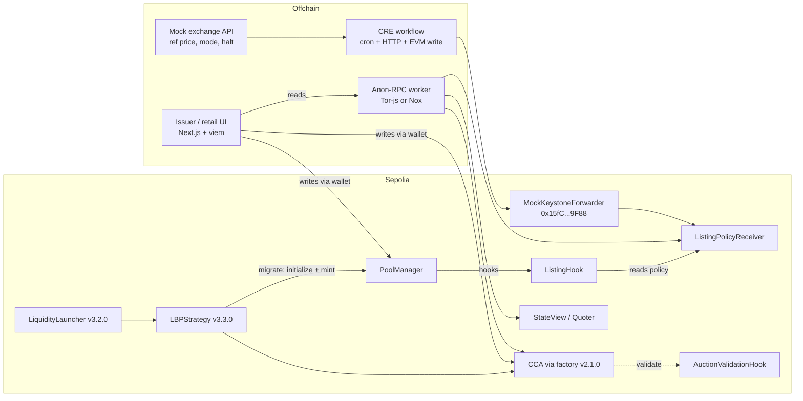
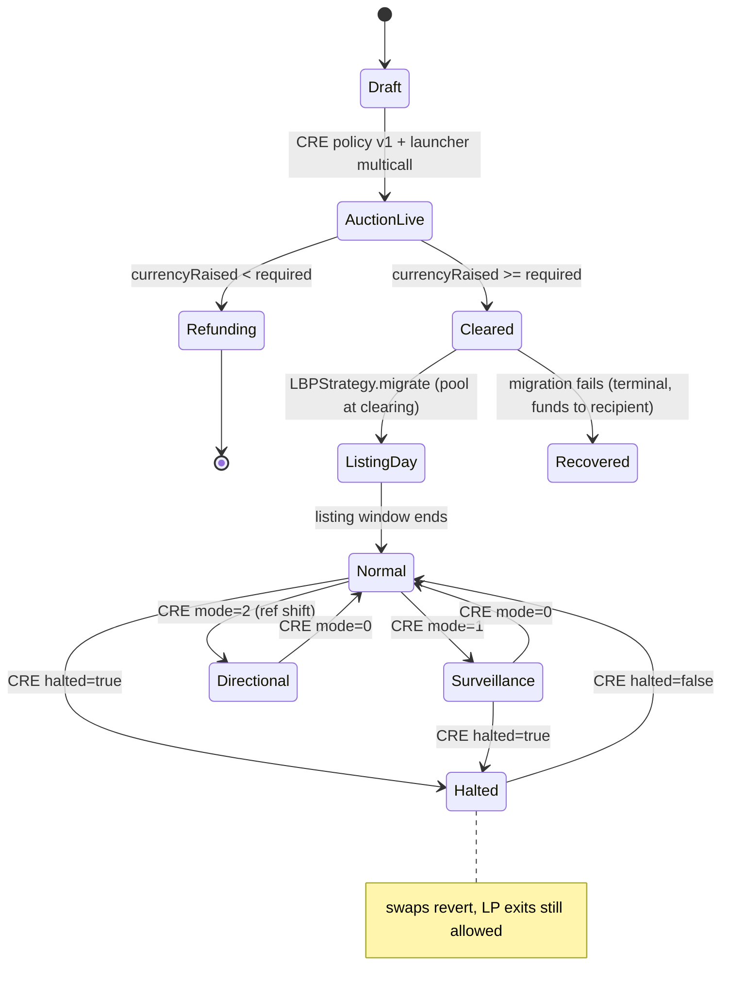

# Listing Day: an SME IPO on Uniswap CCA + v4

> **Public price discovery, private browsing.** A mock Indian SME IPO built on Ethereum Sepolia. Price discovery runs through a Uniswap Continuous Clearing Auction (CCA). The token then graduates into a Uniswap v4 pool, where a `ListingHook` enforces NSE-inspired listing-day and circuit rules. Chainlink CRE posts the listing and incident policy onchain. Every app read goes through Anon-RPC.

- **Event:** ETHGlobal Mumbai, Classic track.
- **Submission deadline:** Sat Nov 7 2026, 09:00 IST. Confirmed on the ETHGlobal Mumbai details page (https://ethglobal.com/events/mumbai/info/details) at Fri Nov 6 ~11:00 IST.
- **Partner prizes (max 3):** Uniswap "Build with Uniswap", Chainlink "Best workflow with CRE" and EF "Best Use of Anon-RPC".
- **Chain:** Ethereum Sepolia (chain id 11155111). Base mainnet is optional and not planned.
- **Scope of this doc:** design only. No code has been written or deployed.
- **Disclaimer:** every exchange rule here is an *NSE-inspired mock*. This is not a regulated product and makes no regulatory claims.

Written Fri Nov 6 2026, about 10:30 IST.

---

## Contents
1. [Pitch](#1-pitch)
2. [Why CCA + v4 fits](#2-why-cca--v4-fits)
3. [Lifecycle](#3-lifecycle)
4. [Components](#4-components)
5. [Diagrams](#5-diagrams)
6. [Rule mapping (NSE-inspired mock)](#6-rule-mapping-nse-inspired-mock)
7. [Mock and demo plan](#7-mock-and-demo-plan)
8. [Build plan to Sat 09:00 IST](#8-build-plan-to-sat-0900-ist)
9. [Risks](#9-risks)
10. [Prize checklists](#10-prize-checklists)
11. [Validation notes](#11-validation-notes)
12. [Reference: addresses and interfaces](#12-reference-addresses-and-interfaces)

---

## 1. Pitch

Indian SME IPOs list through a 45-minute call auction, followed by tight price bands. Listing Day rebuilds that flow onchain:

1. **CCA = the call auction.** Bids are uniform-price and time-weighted, and they are capped at 190% of issue price by an `IValidationHook`.
2. **v4 pool = the secondary market.** It is seeded automatically at the clearing price by LiquidityLauncher's `LBPStrategy`.
3. **ListingHook = the exchange rulebook.** It applies a ±5% listing-day band and a 20% normal band, with surveillance (5%) and directional modes. Swaps that land outside the band revert. LP exits always work.
4. **CRE = the exchange notice board.** A workflow reads a mock exchange API and writes a signed policy report: the reference price, the mode and an optional halt.
5. **Anon-RPC = private browsing.** Investors can check a hot IPO without their IP being tied to the addresses they look up.

| Stack piece | Role | Prize |
|---|---|---|
| Uniswap CCA + LiquidityLauncher + v4 hook | Auction, graduation, rules | Uniswap ($10k pool) |
| Chainlink CRE | Mock exchange API → onchain policy | Chainlink CRE ($1.5k) |
| Anon-RPC | All app reads, private by default | EF Anon-RPC ($5k pool) |

## 2. Why CCA + v4 fits

These are the signals from Uniswap people and docs that the design leans on:

- **CCA is built for this.** The CCA whitepaper cites IPO underpricing as the problem. It names validation hooks and post-auction "compliance gating" as intended extension points. Our cap hook and listing-rules hook are exactly those two extensions.
- **Reference-price hooks are shipping.** StablePair sets a range around a reference price and treats swaps by direction. Swaps that push the price further off pay no fee. Swaps that correct it run a Dutch-auction fee. ([Uniswap](https://x.com/Uniswap/status/2117633841917513745), [Alice Henshaw: "giving mev back to LPs & swappers 1 hook at a time"](https://x.com/hensha256/status/2098106537432510574)). Our directional mode borrows the reference-price idea and turns it into a circuit rule: we *block* gap-widening swaps and allow gap-closing arbitrage.
- **Tokenized stocks are the narrative.** Hayden Adams says StablePair now pairs Robinhood and Ondo tokenized stocks on Robinhood Chain ([post](https://x.com/haydenzadams/status/2115123909511233625)). He also says CCA "is continuing to attract verified token launches" ([post](https://x.com/haydenzadams/status/2115478207088697380)). An equity-style IPO on CCA combines the two.
- **UHI8 theme: asset-class-specific liquidity.** An SME equity has listing-day and circuit rules that a generic pool lacks. That makes it a clear asset-class hook.
- **Routing reality.** Mark Toda says Uniswap is exploring default inclusion of hooked pools in routing, with an automatic denylist for hooks that fail often or execute worse than simulated. Inclusion still requires best price ([post](https://x.com/MarkToda/status/1997286709126386128)). We therefore demo through our own UI and the v4 Quoter and Universal Router. Routing is not something we depend on. See Risks.

## 3. Lifecycle

| # | Phase | What happens | Enforced by |
|---|---|---|---|
| 1 | Draft | Issuer sets the issue price (100), the range (80–190) and the supply. CRE posts listing policy v1. | `ListingPolicyReceiver` |
| 2 | CCA live | Bids open. The floor price is 80. Any bid with `maxPrice` above 190 reverts. | CCA + `AuctionValidationHook` |
| 3 | Clears | If `currencyRaised >= requiredCurrencyRaised`, the auction graduates. If not, bidders exit and get refunds. | CCA |
| 4 | Migrate | `LBPStrategy.migrate()` reads `lbpInitializationParams()`, initializes the v4 pool **at the clearing price** (~110) and mints LP. | LBPStrategy + `ListingHook.beforeInitialize` |
| 5 | Listing day | Band is ±5% around clearing (104.5–115.5). `afterSwap` reverts any swap whose post-price lands outside it. | `ListingHook` |
| 6 | Normal trading | The default band is 20% around the CRE reference (or the hook's recorded previous close if the reference is stale). Surveillance mode tightens it to 5%. Directional mode blocks gap-widening swaps and allows gap-closing ones. An optional hard halt can come from a CRE report. LP add and remove are never blocked. | `ListingHook` + CRE |

Key design rule: **a revert cannot persist state.** A swap that breaches the band cannot "trip" a pause, because its storage writes roll back with the revert. Any pause or halt must therefore arrive as its own successful transaction, a CRE report. Swaps never call CRE: CRE is asynchronous and pushes policy, and the hook only reads it.

## 4. Components

| Component | Purpose | Inputs → outputs | Prize | Est. h |
|---|---|---|---|---|
| `MockSME` ERC-20 (18 dec) | The listed share token | Minted by LiquidityLauncher `createToken`, or a pre-minted deposit | Uni | 0.5 |
| `MockINR`/`mUSDC` (6 dec) | Quote currency, faucet-mintable for demo wallets | `mint(to, amt)` | Uni | 0.5 |
| `ListingPolicyReceiver` | Stores the latest CRE policy. It checks the version and freshness, embeds the chain selector, and keeps `asOf` monotonic. | `onReport(metadata, report)` from the forwarder → `policy()` view | CRE | 1.5 |
| `AuctionValidationHook` | Rejects bids above 190% of issue price | `validate(maxPrice, amount, owner, sender, hookData)` → revert or no-op | Uni | 1 |
| CCA + LiquidityLauncher + LBPStrategy | Auction, then automatic graduation to v4 | AuctionParameters + MigratorParameters → auction, then pool and LP NFT | Uni | 3 |
| `ListingHook` (inherits `InitializerHook`) | Listing-day band, normal band, surveillance, directional mode and halt. LP exits are never blocked. | Flags: `beforeInitialize`, `afterInitialize`, `beforeSwap`, `afterSwap`. It reads `ListingPolicyReceiver`. | Uni | 4 |
| CRE workflow (TypeScript) | Cron → HTTP GET mock exchange API → ABI-encode → `writeReport` | Mock JSON → signed report → receiver | CRE | 2 |
| Mock exchange API | Static or tiny JSON endpoint (GitHub raw or Vercel) with the ref price, mode and halt | Edited during the demo | CRE | 0.5 |
| Issuer + retail UI (Next.js + viem) | Issuer console, bid form, live band chart and swap panel | Reads via Anon-RPC; writes via the wallet | All | 4 |
| Anon-RPC layer | `@anon-rpc/browser-harness` worker becomes the viem `custom` transport, plus a status badge and a read counter | Every `eth_call` / `eth_getLogs` goes through the worker | EF | 2–4 |
| Demo wallets + scripts | 4–6 funded wallets that place bids and run in-band, out-of-band and directional swaps | Foundry scripts | All | 1.5 |

### Contract sketches (design, not code to ship)

```solidity
// Policy struct the CRE report encodes (abi.encode)
struct ListingPolicy {
    uint32  version;        // monotonic
    uint64  asOf;           // cron scheduled time; must increase (replay guard)
    uint64  chainSelector;  // 16015286601757825753 = Ethereum Sepolia (cross-chain replay guard)
    uint160 refSqrtPriceX96;// CRE reference price (pool orientation)
    uint16  normalBandBps;  // 2000
    uint16  survBandBps;    // 500 (or 200)
    uint8   mode;           // 0 normal, 1 surveillance, 2 directional
    bool    halted;         // hard halt
    uint64  coolOffUntil;   // optional timed halt (extension)
}

contract AuctionValidationHook is IValidationHook /* + ValidationHookIntrospection */ {
    uint256 public immutable capQ96; // 1.9 * issue price, Q96, currency per token
    function validate(uint256 maxPrice, uint128, address, address, bytes calldata) external view {
        if (maxPrice > capQ96) revert BidAboveCap(maxPrice, capQ96);
    }
}

contract ListingHook is InitializerHook {
    // constructor(poolManager, authorized = LBPStrategy 0x9543...2000, receiver, listingBandBps=500, listingWindow)
    // getHookPermissions(): beforeInitialize, afterInitialize, beforeSwap, afterSwap = true; everything else false
    // _afterInitialize: listingSqrtP = sqrtPriceX96 (clearing price), listingStart = block.timestamp
    // _beforeSwap: revert if halted / coolOff; tstore pre-swap sqrtP (EIP-1153) for directional mode
    // _afterSwap: read post sqrtP via StateLibrary.getSlot0; compute anchor + band; revert OutOfBand(...)
    //             directional mode: allow iff |post - ref| <= |pre - ref|
    //             roll "previous close" when a new session index starts (first successful swap of the session)
}
```

Notes:
- Compare prices in **sqrtPriceX96 space**. A band of ±b on price is ±(√(1±b) − 1) on sqrtPrice, so precompute the bounds. Mind token order: if `MockSME` is `currency1`, the pool price is quote-per-token inverted.
- Because no add- or remove-liquidity flags are set, LP actions can never be blocked by the hook.
- Use `HookMiner.find(CREATE2_DEPLOYER, flags, creationCode, abi.encode(args))` to mine a salt whose address bits equal the four flags. In tests, use `deployCodeTo`.

## 5. Diagrams

### 5.1 Architecture



### 5.2 Sequence: launch to listing day

```mermaid
sequenceDiagram
  autonumber
  participant I as Issuer
  participant CRE as CRE workflow
  participant R as PolicyReceiver
  participant LL as LiquidityLauncher
  participant L as LBPStrategy
  participant A as CCA
  participant V as AuctionValidationHook
  participant B as Bidder (via Anon-RPC reads)
  participant P as PoolManager
  participant H as ListingHook
  CRE->>R: onReport(policy v1: issue 100, range 80-190)
  I->>LL: multicall(createToken, distributeToken → LBPStrategy)
  LL->>L: onTokensReceived / initialize
  L->>A: factory.create(AuctionParameters{validationHook=V, floor=80})
  B->>A: submitBid(maxPrice, amount)
  A->>V: validate(maxPrice, ...)
  V-->>A: ok (or revert if > 190)
  Note over A: auction ends; clearing ≈ 110
  I->>L: migrate()
  L->>A: lbpInitializationParams()
  L->>P: initialize(key{hooks=H}, sqrtP(110))
  P->>H: beforeInitialize(sender=L) ✓ authorized
  P->>H: afterInitialize → record listing price
  L->>P: mint LP positions
  B->>P: swap (via Universal Router)
  P->>H: beforeSwap (halt check, tstore pre-price)
  P->>H: afterSwap (post price in 104.5–115.5?)
  H-->>P: revert OutOfBand if outside
```

### 5.3 State diagram



## 6. Rule mapping (NSE-inspired mock)

| Real NSE SME rule | Our onchain version | Fidelity |
|---|---|---|
| Opening range: price discovery capped at 90% above issue (NSE/SME/62757, Jul 4 2024) and floored at 20% below (NSE/CMTR/69388, effective Aug 4 2025) | CCA `floorPrice` = 80; `AuctionValidationHook` rejects `maxPrice` > 190 | Close. The cap applies to opening discovery only. |
| Special pre-open session: order entry 9:00–9:45 with a random close between 9:35 and 9:45, matching to 9:55, buffer to 10:00; equilibrium = max executable volume | CCA: continuous uniform-price clearing over a block schedule | Inspired, not identical. CCA clears continuously, not as a single call. |
| No equilibrium → IPO trades at issue price | Not graduated → refunds via `exitBid` | Different by design |
| Listing day: band of 5% for issue size ≤ ₹250 Cr, 20% above (consolidated circular NSE/CMTR/73927) | ±5% around the clearing price in the listing window | Faithful for SME-size issues |
| T2T (trade-for-trade) for the first 10 days | Not modelled | — |
| Emerge normal band 20%; surveillance 5% / 2% | 20% default; CRE `mode=1` → 5% (2% configurable) | Close |
| Orders beyond the band are **rejected**, with no halt | `afterSwap` reverts the swap | Faithful |
| — | Timed cool-off, directional mode | **Our extensions** |
| Market-wide circuit breakers (index-based) | Not modelled | — |

## 7. Mock and demo plan

**Example numbers** (example data):
- Issue 100 mUSDC, range 80–190, supply 1,000,000 MockSME, with 50% to the auction and 50% reserved for LP.
- Clears at ~110, so the listing band is 104.5–115.5.
- On day 2 the CRE reference moves from 110 to 90 (mock "results miss" notice) with directional mode on. Swaps that push the price further above 90 revert. Arbitrage sells toward 90 pass.

| Step | Pool price | CRE ref | Result |
|---|---|---|---|
| Open | 110 | 110 | ok |
| Buy push | 114 | 110 | ok |
| Buy push | 117 | 110 | **revert** (>115.5) |
| Sell | 108 | 110 | ok |
| Listing window ends | 108 | 110 | normal band 88–132 |
| CRE ref → 90, mode=2 | 108 | 90 | — |
| Buy push | 111 | 90 | **revert** (widens gap) |
| Arb sell | 98 | 90 | ok (closes gap) |
| CRE halted=true | 98 | 90 | all swaps revert; LP remove ok |

**Demo script (~3 min):**
1. (0:00) Pitch with the NSE SME flow, one slide.
2. (0:20) Issuer console: CRE `simulate --broadcast` posts policy v1, and the tx shows on Sepolia.
3. (0:40) Bids come in. A bid at 200 reverts with `BidAboveCap`. The badge reads "Reads via Anon-RPC (Tor) 100%".
4. (1:10) The auction ends (pre-run to save blocks) and `migrate()` opens the pool at 110.
5. (1:30) Swaps: an in-band buy passes, and a buy to 117 reverts `OutOfBand`.
6. (2:00) Edit the mock API (ref 90, directional) and re-run CRE. The widening buy reverts and the arbitrage sell passes.
7. (2:30) Halt via CRE: swaps revert and LP removal still works.
8. (2:50) Close: architecture slide and the three prizes.

Pre-record the auction phase: Sepolia blocks take ~12 s, so a 100-block auction lasts ~20 min.

## 8. Build plan to Sat 09:00 IST

About 22 hours remain from Fri 10:30 IST. Times are targets.

**Gate 0 (by Fri 13:00 IST, 2.5 h). All three spikes must pass before anything else:**
1. Anon-RPC worker (Tor-js or Nox, never passthrough) → Sepolia `eth_blockNumber` + `StateView.getSlot0` from the browser.
2. CRE: `cre workflow simulate --target staging-settings --broadcast` → `onReport` on a stub receiver at the mock forwarder, with the tx visible on Etherscan.
3. Foundry fork test on Sepolia: LiquidityLauncher multicall → CCA → `migrate()` with a stub `InitializerHook` (correct flags, mined address) → the pool initializes.

| # | Milestone | Hours | Target (IST) |
|---|---|---|---|
| M1 | Tokens, `ListingPolicyReceiver`, `AuctionValidationHook` + unit tests | 2 | Fri 15:00 |
| M2 | `ListingHook` (bands, modes, halt, prev close) + HookMiner + fork tests | 4 | Fri 19:00 |
| M3 | Launch script: params, deploy, bids, migrate on Sepolia | 3 | Fri 22:00 |
| M4 | CRE workflow (mock API → report) + broadcast runs | 2 | Sat 00:00 |
| M5 | UI (issuer, bid, swap, band chart) + Anon-RPC transport + badge | 4 | Sat 04:00 |
| M6 | Full dress rehearsal, README with line pointers, FEEDBACK.md, form, video, submit | 2.5 | Sat 06:30 |
| — | Buffer | 2.5 | Sat 09:00 |

**Cut list, in order:**
1. Ex-dividend: already cut.
2. Directional mode (keep the code path if tests pass; otherwise drop it).
3. Timed cool-off.
4. UI polish: a minimal UI only.
5. Previous-close roll: fall back to the listing price as the anchor.

## 9. Risks

| Risk | Impact | Mitigation |
|---|---|---|
| A pause can't persist inside a reverting swap | A "trip on breach" breaker is impossible | Reject-only bands, with halts set by CRE report transactions only |
| InstantLaunch is hookless (fixed ETH pool, 1e9 supply, 25 bps, tick spacing 60) | No fallback path to a hooked pool | Use LBPStrategy only, and prove it in Gate 0 |
| LBPStrategy hook rules: ERC165 `IInitializerHook`, `authorized()==LBPStrategy`, valid address for the fee, BEFORE_INITIALIZE, pool uninitialized | `InvalidHook` at registration | Inherit `InitializerHook`, mine the address, use a fresh hook or params per run (`PoolIdOccupied`) |
| Migration failure is terminal (funds go to the recipient; no retry) | The demo run is burned | Fork-test first, and keep a spare token run |
| Routers may skip or denylist hooks that revert often | No aggregator flow | Demo through our UI and Universal Router directly; frame reverts as rule enforcement |
| Anon-RPC integration takes 2–4 h; Nym bundle is ~18 MB | Time | Gate 0 spike; Tor-js first |
| Silent fallback to direct RPC | Fails EF qualification and is dishonest | No fallback: show the error with a retry button, and count reads per transport |
| Anon-RPC doesn't hide queried addresses from the RPC (it unlinks the IP); the bootstrap read isn't anonymized | Overclaiming | Honest privacy note in the UI and README |
| CRE simulation metadata: the mock forwarder sends no workflow metadata | Receiver reverts if workflowId/author checks are set | Forwarder check only during the hackathon |
| Stale CRE reference | Wrong band | `maxAge` → anchor falls back to the hook's previous close |
| Deadline was secondary, now confirmed | Late submission | Confirmed Sat Nov 7 09:00 IST on ethglobal.com/events/mumbai/info/details |

## 10. Prize checklists

**Uniswap "Build with Uniswap" ($4k/3k/2k/1k)**
- [ ] Public GitHub repo, open source
- [ ] `FEEDBACK.md` in the repo root (honest DX notes: docs mismatch on the CCA factory constructor, hook validation errors, InitializerHook docs)
- [ ] Form at https://developers.uniswap.org/hackathon-feedback, linking FEEDBACK.md
- [ ] README points to the exact contracts and lines: `ListingHook.sol` (afterSwap band check), `AuctionValidationHook.sol` (validate), the launch script (LiquidityLauncher multicall + migrate)
- [ ] Uses CCA + LiquidityLauncher/LBPStrategy + a v4 hook on Sepolia, with tx links

**Chainlink "Best workflow with CRE" ($1.5k)**
- [ ] Workflow integrates an external API (mock exchange) with a blockchain (a Sepolia write)
- [ ] CRE is meaningfully used: it drives the pool's mode, reference and halt
- [ ] `cre workflow simulate ... --broadcast` evidence: onReport tx hashes (simulation is accepted)
- [ ] README links to the workflow source and the receiver contract

**EF "Best Use of Anon-RPC" ($2.5k/1.5k/1k; max one EF prize)**
- [ ] App routes RPC reads through Anon-RPC **by default** (the qualification rule)
- [ ] Tor-js or Nox worker, not passthrough
- [ ] The UI shows the transport and its share of traffic (aim for 100% of reads)
- [ ] No silent fallback; honest privacy note
- [ ] Works end to end in the demo video

**ETHGlobal general**
- [ ] Select exactly 3 partner prizes
- [ ] Demo video and project page, submitted before Sat 09:00 IST

## 11. Validation notes

Checked Fri Nov 6 2026 (~10:20 IST) against onchain state (Sepolia block 12,074,309 via public RPC), GitHub sources and the docs and prize pages. Corrections and confirmations:

1. **All Sepolia addresses have code**, including PositionManager `0x429b…09b4`, Universal Router `0x3A9D…F98b` (and 2.1.2 `0x7E4f…43f3`), StateView `0xe1dd…7e4c` and Quoter `0x68aF…8244`. PositionManager, StateView and Quoter each return `poolManager() = 0xE03A…3543`.
2. **LBPStrategy v3.3.0 wiring confirmed onchain.** `initializerFactory()` = CCA factory v2.1.0 `0x0000…63F8`, and `positionManager()` and `poolManager()` match the v4 deployments. Use v2.1.0 rather than v2.0.0.
3. **The CCA fee controller is not a blocker.** On Sepolia, factory v2.1.0 `protocolFeeController()` returns `address(0)`, so protocol fees are off. The repo factory takes a `_protocolFeeController` constructor arg while the deployments page says "no constructor parameters". This is a docs mismatch to note in FEEDBACK.md. It doesn't affect using the canonical deployment.
4. **`IValidationHook.validate(uint256 maxPrice, uint128 amount, address owner, address sender, bytes hookData)`** is confirmed, and it MUST revert to reject. Add `ValidationHookIntrospection` for ERC165.
5. **LBPStrategy hook rules (from `MigratorParams.validateHook`).**
   - The pool must be uninitialized.
   - The hook must pass ERC165 for `IInitializerHook`, have `authorized() == LBPStrategy`, pass `isValidHookAddress(fee)` and have the BEFORE_INITIALIZE flag.
   - **No other permission is restricted**, so afterInitialize, beforeSwap and afterSwap are allowed.
   - The hook can't be the strategy itself.
   - A reused pool id reverts with `PoolIdOccupied`.
6. **Sepolia `InitializerHook` v3.3.0 has `authorized()` = LBPStrategy `0x9543…2000`.** Our ListingHook passes the same address to its constructor, so it can be mined before launch.
7. **The pool opens at the clearing price, not the issue price.** The listing band anchors to clearing.
8. **CRE details.**
   - Sepolia chain selector is `16015286601757825753`.
   - Simulation writes go through MockKeystoneForwarder `0x15fC…9F88` and need `--broadcast` (without it the run is a dry run).
   - The mock forwarder sends no workflow metadata, so don't set workflowId/author checks during simulation.
   - Production metadata is 64 bytes, not 62.
   - Embed `chainSelector` and a monotonic `asOf` to guard against replay.
9. **The Mumbai CRE prize accepts simulation.** It requires a blockchain + external API integration that is meaningfully used.
10. **Anon-RPC.**
    - Qualification is "routes its RPC reads through Anon-RPC by default".
    - The passthrough worker doesn't anonymize, and the bootstrap read isn't anonymized.
    - The RPC still sees queried addresses; Anon-RPC unlinks them from the user's IP.
11. **NSE listing-day band is 5% (issue ≤ ₹250 Cr) / 20% (> ₹250 Cr)**, not "2/5/10% by issue size". The ±5% we use matches SME-size issues.
12. The NSE FAQ's "20% over" is a typo for 20% *below* issue (circular NSE/CMTR/69388).
13. **StablePair is fee-based, not blocking.** Widening swaps pay no fee and correcting swaps pay a Dutch-auction fee. Our *blocking* directional mode is our own extension, not a copy.
14. **Mark Toda's post** is about routing default-inclusion plus an auto-denylist for hooks that fail often. This makes "frequent reverts" a routing risk. It is not a statement that unknown hooks are always excluded.
15. The deadline (Sat Nov 7 2026 09:00 IST) comes from a secondary source; confirm it on the dashboard. Max 3 partner prizes.
16. LiquidityLauncher v3.2.0 `0x0000FffF…19C0` is current. The old v3.0.0 `0x0000…D4e9` still has code; don't use it.
17. Circle test USDC on Sepolia has 6 decimals. We still use a mintable 6-dec mock quote token so demo wallets can self-fund.

## 12. Reference: addresses and interfaces

| Contract (Sepolia) | Address | Code size |
|---|---|---|
| PoolManager | `0xE03A1074c86CFeDd5C142C4F04F1a1536e203543` | 24,009 |
| PositionManager | `0x429ba70129df741B2Ca2a85BC3A2a3328e5c09b4` | 23,877 |
| Universal Router | `0x3A9D48AB9751398BbFa63ad67599Bb04e4BdF98b` | 19,540 |
| Universal Router 2.1.2 | `0x7E4f6c5e954Da5c61B3423D81E2277431Ac043f3` | 24,380 |
| StateView | `0xe1dd9c3fa50edb962e442f60dfbc432e24537e4c` | 3,531 |
| Quoter | `0x68aFa8b853cAa7a2D40B0F6AEE5C4DbC147C8244` | 6,118 |
| Permit2 | `0x000000000022D473030F116dDEE9F6B43aC78BA3` | 9,152 |
| PoolSwapTest | `0x9b6b46e2c869aa39918db7f52f5557fe577b6eee` | — |
| PoolModifyLiquidityTest | `0x0c478023803a644c94c4ce1c1e7b9a087e411b0a` | — |
| CCA factory v2.1.0 | `0x000000001F26a0044BaA66024e7b6599c61963F8` | 24,214 |
| CCA factory v2.0.0 | `0x00cCa200BF124dBfA848937c553864f4B4CE0632` | 24,124 |
| LiquidityLauncher v3.2.0 | `0x0000FffFBE8efE702c8703aE3477FF5dE3d319C0` | 4,127 |
| LBPStrategy v3.3.0 | `0x95434E898Af471945Cab33D5064d2aC1A6Ba2000` | 21,241 |
| InitializerHook v3.3.0 (reference) | `0x1600059B95A80d500fC42400ea9a88A9C29D2000` | 3,104 |
| Circle test USDC (6 dec) | `0x1c7D4B196Cb0C7B01d743Fbc6116a902379C7238` | 1,798 |
| CRE MockKeystoneForwarder | `0x15fC6ae953E024d975e77382eEeC56A9101f9F88` | 4,579 |
| CRE KeystoneForwarder | `0xF8344CFd5c43616a4366C34E3EEE75af79a74482` | 8,591 |
| Anon-RPC Nox specifier | `0x35133267A8F7EC35046a83DCA0f4Ca8A6e1b7A9A` | 3,655 |

**Anon-RPC client sketch.** The Tor-js (`0x700d…659e`) and Nym (`0x3aCD…0eD0`) worker specifiers live on mainnet. The passthrough worker `0x4fd7…8d27` is **not** private.

```ts
import { AnonRpcWorker } from "@anon-rpc/browser-harness";
const worker = new AnonRpcWorker({ address: TOR_OR_NOX_SPECIFIER, config, preExisting: { rpcProvider: SEPOLIA_RPC } });
const client = createPublicClient({ chain: sepolia, transport: custom({ request: (a) => worker.fetch(a) }) });
```

**CRE.** Use `runtime.report(encoded)` then `evmClient.writeReport({ receiver, report })`, with chain name `ethereum-testnet-sepolia`. Run it with `cre workflow simulate listing-policy --target staging-settings --broadcast`.

**Sources**
- Uniswap v4 deployments: https://docs.uniswap.org/contracts/v4/deployments
- Liquidity Launchpad deployments: https://docs.uniswap.org/contracts/liquidity-launchpad/deployments
- liquidity-launcher repo: https://github.com/Uniswap/liquidity-launcher (`src/periphery/hooks/InitializerHook.sol`, `src/libraries/MigratorParams.sol`, `docs/TechnicalReference.md`)
- CCA repo: https://github.com/Uniswap/continuous-clearing-auction (`src/interfaces/IValidationHook.sol`, `docs/TechnicalDocumentation.md`)
- CRE consumer contracts: https://docs.chain.link/cre/guides/workflow/using-evm-client/onchain-write/building-consumer-contracts
- CRE forwarder directory: https://docs.chain.link/cre/guides/workflow/using-evm-client/forwarder-directory-ts
- Anon-RPC: https://ethereum.github.io/anon-rpc/wallets/ and https://ethereum.github.io/anon-rpc/adopters/
- ETHGlobal Mumbai prizes: https://ethglobal.com/events/mumbai/prizes
- NSE special pre-open: https://www.nseindia.com/static/products-services/equity-market-special-pre-open-session
- Prior art: Kura (https://ethglobal.com/showcase/kura-so3wx) and CLOUD (https://cloudonrh.com/hook/)
